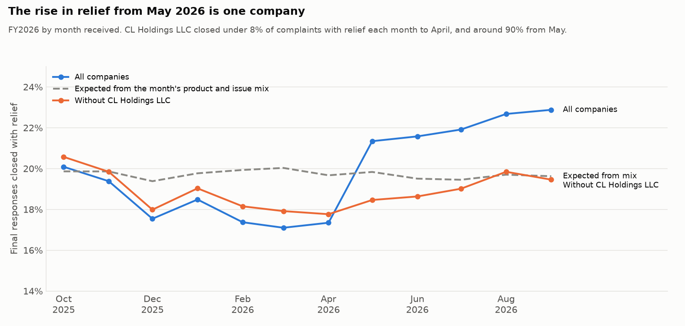

# Consumer complaints analytics: who draws complaints and how companies answer them

[](https://github.com/nisha1324/consumer-complaints-analytics/actions/workflows/ci.yml)

**Status: complete.** Four parts (data profile; where complaints come from; how companies respond; an early-warning monitor) and a summary, each part with its own report and charts, all regenerated and tested by GitHub Actions on every push.

Every complaint a US consumer files with the Consumer Financial Protection Bureau (CFPB) about a bank, lender, card issuer or debt collector is sent to the company for a response and then published. That makes the CFPB's Consumer Complaint Database one of the largest public records of what goes wrong between financial companies and their customers.

This project reads it the way a **complaints, compliance or customer-experience team** at a lender would: which products and problems draw complaints, how companies answer them (relief, timeliness), and how one company compares with its peers once size and product mix are allowed for. It is SQL (DuckDB) and Python, on real public data, with no machine learning.

## Summary

658,443 complaints from US fiscal year 2026, read against 19,397,176 since 2011. The thread through the project: **a complaint figure for the whole market is often one or two companies, so find the company before reading the trend.** Five findings; every figure below comes from the part named beside it.

- **Spikes hide the trend, and a spike is usually one company.** The history has 24 spike months; in 19 of them one company makes up half or more of the extra complaints, and in all 24 the two largest companies do. Counted as filed, money-transfer complaints fell 50.1% from FY2025 to FY2026; with the spike months set to their baseline they rose 37.1%. Underneath, complaints grew in 9 of 10 products. *(Part 2)*
- **Relief rates do not compare well across companies.** 381 of the 419 companies with 100 or more final responses are outside the 99.8% chance limits against peers with the same products and issues, where chance alone would put about one. Allowing for mix barely narrows the gap (18.6 to 17.0 points). In debt collection 190 of 259 collectors closed under 2% of complaints with relief and 8 over 90%, which looks like a recording habit as much as an outcome. *(Part 3)*
- **One company moved the market's relief rate.** Relief went from 18.3% (October to March) to 21.2% (April to September). CL Holdings LLC closed 1.5% of its complaints with relief up to April and 90.4% from May; without it the rate is flat (18.9% to 18.8%). *(Part 3)*
- **Late responses are a few companies' problem.** 3.8% of final responses were late, and 8 companies make up half of them. Without MOHELA and the entry "Servicer under contract with Federal Student Aid", 1.2% of student-loan responses were late, not 34.4%. *(Part 3)*
- **A weekly monitor is cheap to run and to staff.** Through FY2026 it would have sent 61 items in 43 weeks, about 1.4 a week and never more than 6. 12 of its 49 surges do not survive without identical repeat complaints, 20 are shared with another company on the same issue in the same week, and it flagged CL Holdings' change the week after it began. *(Part 4)*



### What a complaints team should take from it

Ranked by how directly the figures support them. They are written for a complaints, compliance or customer-experience team at a lender. The data cannot say which company serves its customers best, because it has no customer counts and companies seem to record relief differently.

| # | Recommendation | For | Evidence |
| ---: | --- | --- | --- |
| 1 | **Check for a spike before reading any year-on-year change in complaints, find the company behind it, and report the figure both with and without it.** | Complaints reporting analysts, board reporting | Part 2: money transfers −50.1% as counted, +37.1% without spike months; one company is half or more of the extra complaints in 19 of 24 spikes |
| 2 | **Compare your relief rate with your own history, not with other companies' published rates.** Compare timeliness with peers, with the few companies that dominate it split out. | Compliance, customer-experience leads | Part 3: 381 of 419 companies outside the 99.8% limits; 190 of 259 collectors under 2% relief and 8 over 90%; 8 companies make up half of late responses |
| 3 | **Run a weekly monitor on complaints per company, product and issue, and on relief and late rates.** | Complaints operations | Part 4: 61 items in 43 weeks, about 1.4 a week, never more than 6; it flagged CL Holdings' change the week after it began |
| 4 | **Remove identical repeat complaints before alerting or ranking.** | Data and analytics team | Part 4: 12 of 49 surges do not survive without them. Part 2: without them CL Holdings drops from first to second and Encore Capital from fourth to seventh |
| 5 | **Before treating a surge as your own failure, check whether competitors alerted on the same issue that week.** | Complaints operations, risk | Part 4: 20 of 49 surge episodes are shared; the three credit bureaus account for 9, on just two issues |
| 6 | **Explain any step change in your own outcome mix before it reaches a board report.** | Compliance, internal audit | Part 3: CL Holdings went from 1.5% to 90.4% relief and moved the all-company rate by 3.2 points |
| 7 | **Start root-cause work with each product's top issue.** | Product owners, operations | Part 2: debts people say they don't owe are 43.3% of debt collection; managing an account is 58.1% of bank accounts |

What this analysis cannot do is in [Limits](#limits). The three that matter most: complaints are not a sample of customers and the data has no customer counts, so nothing here is a complaint rate per customer; relief is the company's own description of its response, apparently recorded differently from company to company, and not verified by the CFPB; and the monitor's backtest has one year and no list of real incidents, so it measures workload and what size of surge is caught, not how many alerts were right. Where a spike lines up with a public event, timing alone does not show cause.

## The data

- **Source:** [Consumer Complaint Database](https://www.consumerfinance.gov/data-research/consumer-complaints/), US Consumer Financial Protection Bureau. Public domain (a US Government work); no key or sign-up.
- **Bulk file:** [`complaints.csv.zip`](https://files.consumerfinance.gov/ccdb/complaints.csv.zip), 371 MB zipped (5.9 GB unzipped), 19,397,176 complaints from December 2011 to 23 November 2026, 15 columns ([field definitions](https://cfpb.github.io/api/ccdb/fields.html)). The copy used here is dated 24 November 2026; its SHA-256 is in [`data/SNAPSHOT.json`](data/SNAPSHOT.json).
- **Two 2026 changes** ([release notes](https://cfpb.github.io/api/ccdb/release-notes.html)): the CFPB **removed consumers' complaint narratives** in September 2026, so there is no free text, only the structured fields; and API exports are now capped at 100,000 complaints, so this project uses the full bulk file.
- **What is committed** (all three rebuilt byte for byte from that bulk file, SHA-256 pinned in [`complaints/source.py`](complaints/source.py)):
  - [`data/complaints_fy2026.parquet`](data/complaints_fy2026.parquet) (5.8 MB): one row per complaint received in US federal fiscal year 2026 (1 October 2025 to 30 September 2026) about any product except credit reporting: **658,443 complaints**.
  - [`data/monthly_by_product.csv`](data/monthly_by_product.csv): complaints per month and product for the whole history, credit reporting included.
  - [`data/monthly_by_company.parquet`](data/monthly_by_company.parquet) (1.4 MB, added in Part 2): complaints per month, product, sub-product and company for the whole history (557,414 rows). The sub-product maps old product names onto current ones; the company shows who is behind a surge.

**Why leave credit reporting out of the row-level data?** It was 90.6% of all complaints in FY2026 (6.3 million). It is a different kind of complaint, about consumer reports rather than a product the consumer chose, and at that size it would swamp every other product. It stays in the monthly history.

**What the CFPB says about the data, and what it means here.** Complaints are published only once sent to a company; complaints the CFPB refers to other regulators (for example about banks and credit unions with under $10 billion in assets) are not published, so small banks are largely missing. The database "is not a statistical sample of consumers' experiences", and complaint counts should be read against company size, which the data does not include. So this project compares companies on **rates** (how they respond) and on **mix**, not on raw counts.

## Roadmap

| Part | What | Status |
| --- | --- | --- |
| 1 | **Source, snapshot and data profile**: the history, the product mix, company concentration, a column profile and 21 data-quality checks | done: [`results/PROFILE.md`](results/PROFILE.md) |
| 2 | **Where complaints come from**: old product names mapped to current ones, spike months and the companies behind them, growth with and without spikes, the issue mix, and whether the repeats change anything | done: [`results/WHERE_COMPLAINTS_COME_FROM.md`](results/WHERE_COMPLAINTS_COME_FROM.md) |
| 3 | **How companies respond**: relief and timeliness by product and company, compared with peers after allowing for product and issue mix, with limits for what chance alone would produce | done: [`results/HOW_COMPANIES_RESPOND.md`](results/HOW_COMPANIES_RESPOND.md) |
| 4 | **Early-warning monitor**: weekly surges per company and issue against each series' own past weeks, and step changes in each company's relief and late rates, backtested on FY2026 | done: [`results/EARLY_WARNING_MONITOR.md`](results/EARLY_WARNING_MONITOR.md) |
| 5 | **Write-up**: summary, ranked recommendations and limitations | done: [Summary](#summary) |

The project was first planned with an LLM-assisted categoriser of complaint narratives. The CFPB removed the narratives in September 2026, before this project started, so that part cannot be built on this source; Part 4 is a monitor on the structured fields instead.

## Part 1: source, snapshot and data profile

Full report: [`results/PROFILE.md`](results/PROFILE.md) (generated by [`scripts/profile_report.py`](scripts/profile_report.py) from the SQL in [`sql/`](sql/)).


- **The database grew 26-fold in seven years, and credit reporting is most of it.** Complaints rose from 266,751 in FY2019 to 7,007,745 in FY2026; credit reporting went from 48.5% to 90.6% of them. Every other product together went from 137,421 to 658,443 (4.8-fold).
- **One month can swamp a trend.** January 2025 had 109,916 complaints about products other than credit reporting, three times the month before; money transfers and checking or savings accounts make up 83% of the increase. The data does not say why. Part 2 looks for surges like this before reading any trend.
- **Debt collection is half of the snapshot** (324,870 complaints, 49.3%), then credit cards (14.6%) and checking or savings accounts (13.5%).
- **Complaints are concentrated.** The 10 most-complained-about companies draw 30.8% of complaints and 22 companies draw half, while 1,104 of 3,989 companies have a single complaint. Raw counts say as much about size as about service, which is why Part 3 works with rates.


**The data is clean where it matters, with five traps.** No duplicate IDs, no dates out of order and no timeliness flag missing. The traps, and how later parts handle them:

| Trap | Size | Handling |
| --- | ---: | --- |
| Responses not final yet | 1,743 still in progress, 1,275 of them from September 2026 | measure outcomes on final responses only |
| "Not timely" comes in two forms | 15,098 "Untimely response" + 9,575 closed late = 24,673 (3.7%) | count both |
| Complaints identical to an earlier one on every field except the ID | 17,349 (2.6%), 85% of them in debt collection | keep, flag, and check findings without them |
| The same company spelled two ways | 4 companies, 392 complaints | merge before ranking |
| ZIP codes masked for small areas (by the CFPB's published rule) | 66,485 show 3 digits, 6,312 none | use state, or 3-digit ZIP areas |

All 21 checks with what each means, the column profile and the company table are in [`results/PROFILE.md`](results/PROFILE.md).

## Part 2: where complaints come from

Full report: [`results/WHERE_COMPLAINTS_COME_FROM.md`](results/WHERE_COMPLAINTS_COME_FROM.md) (generated by [`scripts/sources_report.py`](scripts/sources_report.py); the product map is in [`complaints/taxonomy.py`](complaints/taxonomy.py), the rest in [`sql/`](sql/)).

**Method.** The CFPB renamed and regrouped its products in 2017 and 2023, so every complaint in the history is first put under the product it would be filed under today. 2,672,241 complaints move: 2,670,877 filed under product names that no longer exist, and 1,364 filed under a sub-product that has since moved to another product. Products that were later split are mapped by sub-product, and the total stays at 19,397,176. A month is then flagged as a **spike** when it is at least 1.5 times both the median of the 12 months before and the median of the 6 months after, and at least 250 complaints above them. Comparing with the months after as well as before separates a one-off from a new level. Each spike's extra complaints are split by company, and the shares add up exactly.


- **A spike is usually one company.** The history has 24 spike months. In 19 of them one company makes up half or more of the extra complaints, and in all 24 the two largest companies do. In January 2025 Block, Inc. and Early Warning Services made up 97% of the money-transfer spike (49,743 complaints against a usual 2,738). Some spikes come in the same month as a public event about the company behind them, or the month after it: the CFPB's lawsuit against Navient (January 2017), Equifax's data breach (September 2017), and the CFPB's December 2022 order against Wells Fargo. The order was followed in January 2023 by Wells Fargo-led spikes in bank accounts, mortgages and vehicle loans, the three areas it named. Timing alone does not show cause.
- **Spikes distort year-on-year figures.** Counted as filed, money-transfer complaints fell 50.1% from FY2025 to FY2026; with the spike months set to their baseline they rose 37.1%. Bank accounts go from +12.9% to +35.1%, student loans from −3.4% to +11.2%.
- **Underneath, complaints grew in 9 of 10 products** (credit reporting aside), led by payday and personal loans (+59.1%), mortgages (+45.7%) and vehicle loans (+38.6%). Prepaid cards are flat (−1.2%). The growth is broad: in every product more companies gained complaints than lost them.
- **No spike falls inside the FY2026 snapshot**, by month (under all four thresholds tried) or by week. The mix that Parts 3 and 4 build on is not one event's footprint.
- **The top issue in each product shows where to start**: debts people say they don't owe (43.3% of debt collection), problems with a purchase shown on a statement (32.1% of credit cards), managing an account (58.1% of bank accounts), fraud or scams (28.9% of money transfers).
- **The repeats and two-way spellings change nothing material**, except the order at the top of the company ranking. Without the 17,349 repeats, CL Holdings drops from first to second and Encore Capital from fourth to seventh. Both have more repeats than average.


**So what for a complaints or compliance team:** check for a spike before reading any year-on-year change, and report both figures. When a spike comes, look for the company first, and be ready for a surge after public news about your own firm. Judge a rise in your own complaints against the market's rise, since FY2026 growth was broad (Part 3 does this against peers). Start root-cause work with each product's top issue.

## Part 3: how companies respond

Full report: [`results/HOW_COMPANIES_RESPOND.md`](results/HOW_COMPANIES_RESPOND.md) (generated by [`scripts/response_report.py`](scripts/response_report.py); the tables in [`complaints/response.py`](complaints/response.py), the queries in [`sql/`](sql/)).

**Method.** Outcomes are read on the 656,700 final responses (the 1,743 still in progress are left out), and "late" counts both forms of not timely. A company's relief rate depends on what it is complained about, so each company is compared with an **expected** rate: for every one of its complaints, the rate of all *other* companies on the same product and issue. Funnel-plot limits show how far from that a company would land by chance alone. The 419 companies with 100 or more final responses are compared.


- **One complaint in five ends with relief**: 19.7%, and 5.0% with money. Relief is not one scale: for credit cards 59% of it is monetary, in debt collection almost none (428 of 74,581).
- **Companies differ far more than chance allows, even against peers with the same products and issues.** 381 of the 419 are outside the 99.8% limits, where chance alone would put about one: 325 below their peers and 56 above. Allowing for mix barely narrows the gap (the average distance goes from 18.6 to 17.0 points), though it turns six mortgage, student-loan and personal-loan companies from "below average" into "above peers".
- **In debt collection, relief looks like a recording habit as much as an outcome.** 190 of 259 collectors closed under 2% of complaints with relief and 8 over 90%. On the same issue ("attempts to collect debt not owed"), 85 of 136 collectors are under 2% and 8 over 90%. So a company's relief rate is only safely compared with its own history.
- **The year's rise in relief is one company.** Relief went from 18.3% (October to March) to 21.2% (April to September), while the rate expected from the mix stayed between 19.4% and 20.0%. CL Holdings LLC (99% of its complaints are about debt collection) closed 1.5% of its complaints with relief up to April and 90.4% from May. Without it the rate is flat (18.9% to 18.8%). The data does not say whether it changed how it handles complaints or how it records them.
- **Late responses are a few companies' problem.** 3.8% of final responses were late. 8 companies make up half of them. MOHELA (73% of its 7,256 late) and the entry "Servicer under contract with Federal Student Aid" (100% of 4,123) make up 38%. Without those two, 1.2% of student-loan responses were late, not 34.4%. 181 of the 419 large companies were never late.
- **The repeats change nothing**: 417 of 418 companies keep the same verdict without them.


**So what for a complaints or compliance team:** don't benchmark your relief rate against other companies' published rates without knowing how they record relief. Compare it with your own history, and with peers on timeliness, which the CFPB flags the same way for everyone. Watch your own outcome mix for step changes like CL Holdings': one company's change moved the relief rate across all companies by 3.2 points, and a change like that in your own data needs an explanation before it reaches a board report.

## Part 4: an early-warning monitor

Full report: [`results/EARLY_WARNING_MONITOR.md`](results/EARLY_WARNING_MONITOR.md) (generated by [`scripts/monitor_report.py`](scripts/monitor_report.py); the rules in [`complaints/monitor.py`](complaints/monitor.py), the weekly queries in [`sql/monitor_volume.sql`](sql/monitor_volume.sql) and [`sql/monitor_outcomes.sql`](sql/monitor_outcomes.sql)).

**Method.** What would a team have seen week by week if a simple monitor had run through FY2026? The monitor only looks back, as it would on the day it runs. **Volume:** for each of the 22,346 series (one company, product and issue), a week alerts when it is at least twice the median of the 8 weeks before and at least 20 complaints above it; consecutive alert weeks are one episode. **Outcomes:** for each of the 415 companies with 100+ final responses, an alert when the relief or late rate of the latest 4 weeks is 20+ points from the 12 weeks before them and beyond the 99.8% chance limit. The backtest covers the 43 weeks from December 2025 to September 2026.


- **The workload is small.** Across the whole market the monitor would have sent 61 items in 43 weeks (39 volume surges, 22 outcome shifts): about 1.4 a week, never more than 6, with 15 quiet weeks. No company would have had more than 5 all year.
- **Most surges are one-offs.** 34 of the 49 surge episodes fell back below the alert level within 4 weeks; 9 stayed high, like Rocket Mortgage's "trouble during payment process" complaints, whose median in the 4 weeks after the episode was 2.4 times the old level.
- **12 of the 49 surges do not survive without identical repeat complaints.** In those, 51% of the complaints are repeats, against 6% in the rest. Repeats are 2.6% of complaints but 13.4% of the complaints in alert weeks.
- **20 of the 49 episodes are shared with another company on the same issue in the same week.** The three nationwide credit bureaus account for 9, on just two issues. A shared surge points to something across the market, not one company's service.
- **The outcome monitor dates step changes.** It flagged 14 shifts in relief and 8 in lateness, including all 4 companies whose relief Part 3 found moving between the two halves of the year. CL Holdings' change began in the week of 27 April 2026 and is flagged the week after.
- **Small series stay quiet by design.** The 20-complaint floor means a series with under 5 complaints a week is almost never flagged, while in series of 20+ a week an extra week's worth of complaints is caught about half the time and twice that every time. The report shows the workload at six other settings.


**So what for a complaints or compliance team:** a weekly monitor like this is cheap to run and to staff. Remove identical repeats before alerting: 12 of the 49 surges here would not have alerted without them. Check whether competitors alerted on the same issue in the same week before treating a surge as your own failure. Expect most surges to fall back, and give root-cause time to the ones that don't. Watch outcome rates as well as volumes: a step change in relief or lateness does not show up in complaint counts.

## How to run

```bash
uv venv .venv && uv pip install -r requirements-lock.txt   # or: python -m venv .venv && pip install -r requirements-lock.txt
.venv/bin/python scripts/download_data.py                   # check the committed data against the pinned hashes
.venv/bin/python scripts/profile_report.py                  # Part 1: results/PROFILE.md, 6 CSVs, charts 01-04
.venv/bin/python scripts/sources_report.py                  # Part 2: results/WHERE_COMPLAINTS_COME_FROM.md, 8 CSVs, charts 05-08
.venv/bin/python scripts/response_report.py                 # Part 3: results/HOW_COMPANIES_RESPOND.md, 7 CSVs, charts 09-12
.venv/bin/python scripts/monitor_report.py                  # Part 4: results/EARLY_WARNING_MONITOR.md, 7 CSVs, charts 13-15
.venv/bin/python -m pytest -q                               # tests
```

`python scripts/download_data.py --rebuild` downloads the current bulk file (371 MB, about 6.3 GB of disk while it runs) and rebuilds the three data files. The CFPB replaces the file every day and companies keep answering recent complaints, so a later rebuild gives slightly different files: the script reports both hashes, and the analysis stays on the pinned snapshot.

## Project layout

```
complaints/        source.py (where the data comes from, pinned hashes), build.py (bulk file -> snapshot),
                   load.py (DuckDB views), profile.py (Part 1 tables), taxonomy.py (old -> current
                   product names), mix.py (Part 2 tables), response.py (Part 3 tables),
                   monitor.py (Part 4 alert rules and backtest)
sql/               every query behind the reports, one file each
scripts/           download_data.py, profile_report.py, sources_report.py, response_report.py,
                   monitor_report.py
data/              the committed snapshot, the monthly history and SNAPSHOT.json
results/           PROFILE.md, WHERE_COMPLAINTS_COME_FROM.md, HOW_COMPANIES_RESPOND.md,
                   EARLY_WARNING_MONITOR.md, their CSVs and charts (all generated)
tests/             the builder, the profile queries, the spike rule, the peer comparison and the
                   monitor on hand-made data, the committed data against pandas, and byte-for-byte
                   regeneration of every report
```

## Limits

- Complaints are not a sample of customers: they come from people who chose to complain to the CFPB, and complaints the CFPB refers to other regulators (for example about banks and credit unions with under $10 billion in assets) are not published.
- The data has no customer counts, so complaint volumes cannot be turned into complaint rates per customer.
- No narratives: everything comes from 15 structured fields, chosen by the consumer from the CFPB's lists of products and issues.
- The snapshot is one fiscal year and one copy of a database that changes daily; the most recent months' responses were still being filled in.
- The spike rule's thresholds are a choice. The report shows four settings: the count of spike months changes (11 to 32), but none finds a spike in FY2026. Months from May 2026 have fewer than six months after them, so they are checked against the months before only.
- Relief and explanation are the company's own description of its response, and companies seem to record relief differently; the CFPB does not verify them. Expected rates allow for product and issue only.
- "Debt or credit management" only became a product in August 2023, and some of its sub-products have no earlier equivalent, so its long-run growth is not like for like.
- The monitor's backtest has one year and no list of real incidents to score against, so it measures workload and what size of surge would be caught, not how many alerts were right. Weeks are by date received; a live monitor would see complaints and outcomes later, by a delay the data does not record.
