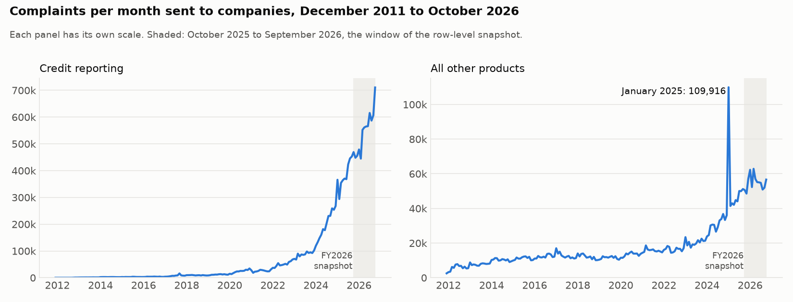
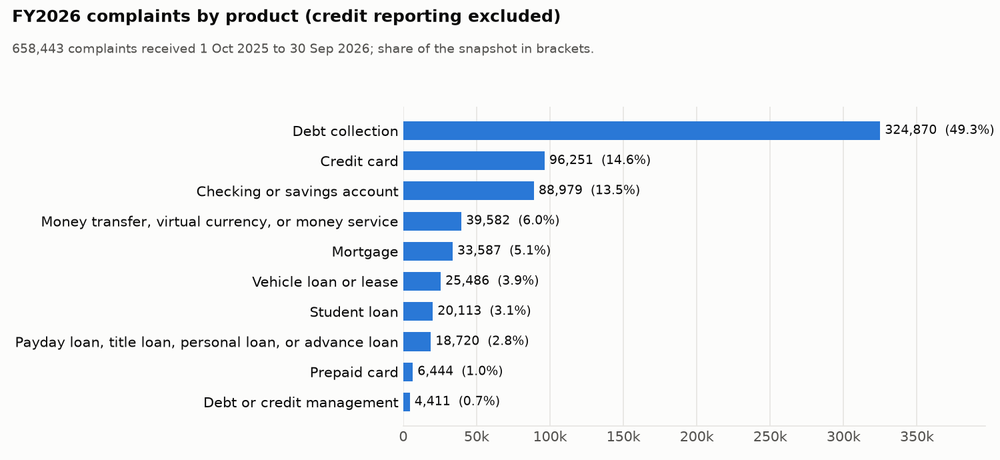
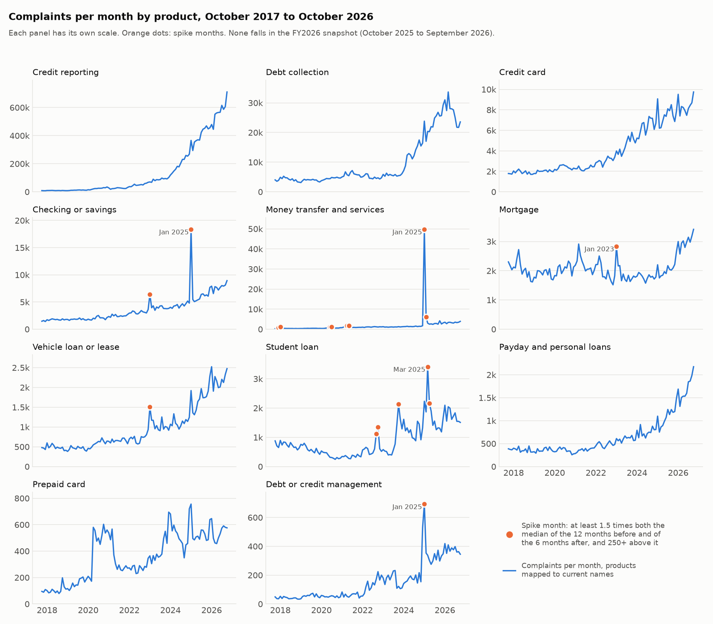
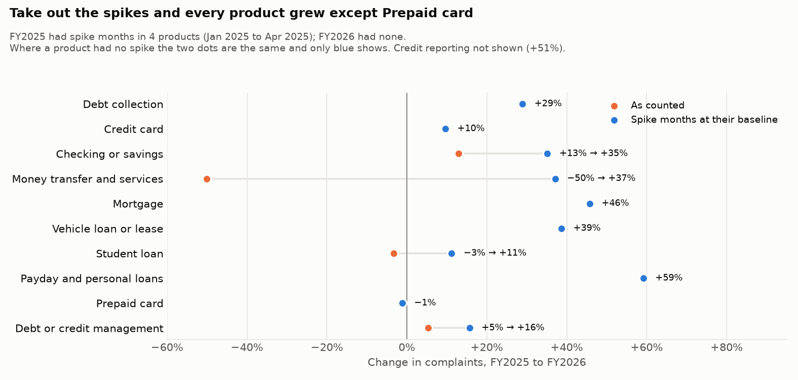

# Consumer complaints analytics: who draws complaints and how companies answer them

[](https://github.com/nisha1324/consumer-complaints-analytics/actions/workflows/ci.yml)

**Status: in progress. Parts 1 and 2 of 5 are done (data profile; where complaints come from).**

Every complaint a US consumer files with the Consumer Financial Protection Bureau (CFPB) about a bank, lender, card issuer or debt collector is sent to the company for a response and then published. That makes the CFPB's Consumer Complaint Database one of the largest public records of what goes wrong between financial companies and their customers.

This project reads it the way a **complaints, compliance or customer-experience team** at a lender would: which products and problems draw complaints, how companies answer them (relief, timeliness), and how one company compares with its peers once size and product mix are allowed for. It is SQL (DuckDB) and Python, on real public data, with no machine learning.

## The data

- **Source:** [Consumer Complaint Database](https://www.consumerfinance.gov/data-research/consumer-complaints/), US Consumer Financial Protection Bureau. Public domain (a US Government work); no key or sign-up.
- **Bulk file:** [`complaints.csv.zip`](https://files.consumerfinance.gov/ccdb/complaints.csv.zip), 371 MB zipped (5.9 GB unzipped), 19,397,176 complaints from December 2011 to 23 November 2026, 15 columns ([field definitions](https://cfpb.github.io/api/ccdb/fields.html)). The copy used here is dated 24 November 2026; its SHA-256 is in [`data/SNAPSHOT.json`](data/SNAPSHOT.json).
- **Two 2026 changes** ([release notes](https://cfpb.github.io/api/ccdb/release-notes.html)): the CFPB **removed consumers' complaint narratives** in September 2026, so there is no free text, only the structured fields; and API exports are now capped at 100,000 complaints, so this project uses the full bulk file.
- **What is committed** (all three rebuilt byte for byte from that bulk file, SHA-256 pinned in [`complaints/source.py`](complaints/source.py)):
  - [`data/complaints_fy2026.parquet`](data/complaints_fy2026.parquet) (5.8 MB): one row per complaint received in US federal fiscal year 2026 (1 October 2025 to 30 September 2026) about any product except credit reporting: **658,443 complaints**.
  - [`data/monthly_by_product.csv`](data/monthly_by_product.csv): complaints per month and product for the whole history, credit reporting included.
  - [`data/monthly_by_company.parquet`](data/monthly_by_company.parquet) (1.4 MB, added in Part 2): complaints per month, product, sub-product and company for the whole history (557,414 rows). The sub-product maps old product names onto current ones; the company shows who is behind a surge.

**Why leave credit reporting out of the row-level data?** It was 90.6% of all complaints in FY2026 (6.3 million). It is a different kind of complaint, about consumer reports rather than a product the consumer chose, and at that size it would swamp every other product. It stays in the monthly history.

**What the CFPB says about the data, and what it means here.** Complaints are published only once sent to a company; complaints the CFPB refers to other regulators (for example about banks and credit unions with under $10 billion in assets) are not published, so small banks are largely missing. The database "is not a statistical sample of consumers' experiences", and complaint counts should be read against company size, which the data does not include. So this project compares companies on **rates** (how they respond) and on **mix**, not on raw counts.

## Roadmap

| Part | What | Status |
| --- | --- | --- |
| 1 | **Source, snapshot and data profile**: the history, the product mix, company concentration, a column profile and 21 data-quality checks | done: [`results/PROFILE.md`](results/PROFILE.md) |
| 2 | **Where complaints come from**: old product names mapped to current ones, spike months and the companies behind them, growth with and without spikes, the issue mix, and whether the repeats change anything | done: [`results/WHERE_COMPLAINTS_COME_FROM.md`](results/WHERE_COMPLAINTS_COME_FROM.md) |
| 3 | **How companies respond**: relief and timeliness by product and company, compared with peers after allowing for product and issue mix, with limits for what chance alone would produce | next |
| 4 | **Early-warning monitor**: weekly complaint counts per company and issue, flagging surges against each series' own history | planned |
| 5 | **Write-up**: summary, ranked recommendations and limitations | planned |

The project was first planned with an LLM-assisted categoriser of complaint narratives. The CFPB removed the narratives in September 2026, before this project started, so that part cannot be built on this source.

## Part 1: source, snapshot and data profile

Full report: [`results/PROFILE.md`](results/PROFILE.md) (generated by [`scripts/profile_report.py`](scripts/profile_report.py) from the SQL in [`sql/`](sql/)).



- **The database grew 26-fold in seven years, and credit reporting is most of it.** Complaints rose from 266,751 in FY2019 to 7,007,745 in FY2026; credit reporting went from 48.5% to 90.6% of them. Every other product together went from 137,421 to 658,443 (4.8-fold).
- **One month can swamp a trend.** January 2025 had 109,916 complaints about products other than credit reporting, three times the month before; money transfers and checking or savings accounts make up 83% of the increase. The data does not say why. Part 2 looks for surges like this before reading any trend.
- **Debt collection is half of the snapshot** (324,870 complaints, 49.3%), then credit cards (14.6%) and checking or savings accounts (13.5%).
- **Complaints are concentrated.** The 10 most-complained-about companies draw 30.8% of complaints and 22 companies draw half, while 1,104 of 3,989 companies have a single complaint. Raw counts say as much about size as about service, which is why Part 3 works with rates.



**The data is clean where it matters, with five traps.** No duplicate IDs, no dates out of order and no timeliness flag missing. The traps, and how later parts handle them:

| Trap | Size | Handling |
| --- | ---: | --- |
| Responses not final yet | 1,743 still in progress, 1,275 of them from September 2026 | measure outcomes on final responses only |
| "Not timely" comes in two forms | 15,098 "Untimely response" + 9,575 closed late = 24,673 (3.7%) | count both |
| Complaints identical to an earlier one on every field except the ID | 17,349 (2.6%), 85% of them in debt collection | keep, flag, and check findings without them |
| The same company spelled two ways | 4 companies, 392 complaints | merge before ranking |
| ZIP codes masked for small areas (by the CFPB's published rule) | 66,485 show 3 digits, 6,312 none | use state, or 3-digit ZIP areas |

All 21 checks with what each means, the column profile and the company table are in [`results/PROFILE.md`](results/PROFILE.md).

## Part 2: where complaints come from

Full report: [`results/WHERE_COMPLAINTS_COME_FROM.md`](results/WHERE_COMPLAINTS_COME_FROM.md) (generated by [`scripts/sources_report.py`](scripts/sources_report.py); the product map is in [`complaints/taxonomy.py`](complaints/taxonomy.py), the rest in [`sql/`](sql/)).

**Method.** The CFPB renamed and regrouped its products in 2017 and 2023, so every complaint in the history is first put under the product it would be filed under today. 2,672,241 complaints move: 2,670,877 filed under product names that no longer exist, and 1,364 filed under a sub-product that has since moved to another product. Products that were later split are mapped by sub-product, and the total stays at 19,397,176. A month is then flagged as a **spike** when it is at least 1.5 times both the median of the 12 months before and the median of the 6 months after, and at least 250 complaints above them. Comparing with the months after as well as before separates a one-off from a new level. Each spike's extra complaints are split by company, and the shares add up exactly.



- **A spike is usually one company.** The history has 24 spike months. In 19 of them one company makes up half or more of the extra complaints, and in all 24 the two largest companies do. In January 2025 Block, Inc. and Early Warning Services made up 97% of the money-transfer spike (49,743 complaints against a usual 2,738). Some spikes come in the same month as a public event about the company behind them, or the month after it: the CFPB's lawsuit against Navient (January 2017), Equifax's data breach (September 2017), and the CFPB's December 2022 order against Wells Fargo. The order was followed in January 2023 by Wells Fargo-led spikes in bank accounts, mortgages and vehicle loans, the three areas it named. Timing alone does not show cause.
- **Spikes distort year-on-year figures.** Counted as filed, money-transfer complaints fell 50.1% from FY2025 to FY2026; with the spike months set to their baseline they rose 37.1%. Bank accounts go from +12.9% to +35.1%, student loans from −3.4% to +11.2%.
- **Underneath, complaints grew in 9 of 10 products** (credit reporting aside), led by payday and personal loans (+59.1%), mortgages (+45.7%) and vehicle loans (+38.6%). Prepaid cards are flat (−1.2%). The growth is broad: in every product more companies gained complaints than lost them.
- **No spike falls inside the FY2026 snapshot**, by month (under all four thresholds tried) or by week. The mix that Parts 3 and 4 build on is not one event's footprint.
- **The top issue in each product shows where to start**: debts people say they don't owe (43.3% of debt collection), problems with a purchase shown on a statement (32.1% of credit cards), managing an account (58.1% of bank accounts), fraud or scams (28.9% of money transfers).
- **The repeats and two-way spellings change nothing material**, except the order at the top of the company ranking. Without the 17,349 repeats, CL Holdings drops from first to second and Encore Capital from fourth to seventh. Both have more repeats than average.



**So what for a complaints or compliance team:** check for a spike before reading any year-on-year change, and report both figures. When a spike comes, look for the company first, and be ready for a surge after public news about your own firm. Judge a rise in your own complaints against the market's rise, since FY2026 growth was broad (Part 3 does this against peers). Start root-cause work with each product's top issue.

## How to run

```bash
uv venv .venv && uv pip install -r requirements-lock.txt   # or: python -m venv .venv && pip install -r requirements-lock.txt
.venv/bin/python scripts/download_data.py                   # check the committed data against the pinned hashes
.venv/bin/python scripts/profile_report.py                  # Part 1: results/PROFILE.md, 6 CSVs, charts 01-04
.venv/bin/python scripts/sources_report.py                  # Part 2: results/WHERE_COMPLAINTS_COME_FROM.md, 8 CSVs, charts 05-08
.venv/bin/python -m pytest -q                               # tests
```

`python scripts/download_data.py --rebuild` downloads the current bulk file (371 MB, about 6.3 GB of disk while it runs) and rebuilds the three data files. The CFPB replaces the file every day and companies keep answering recent complaints, so a later rebuild gives slightly different files: the script reports both hashes, and the analysis stays on the pinned snapshot.

## Project layout

```
complaints/        source.py (where the data comes from, pinned hashes), build.py (bulk file -> snapshot),
                   load.py (DuckDB views), profile.py (Part 1 tables), taxonomy.py (old -> current
                   product names), mix.py (Part 2 tables)
sql/               every query behind the reports, one file each
scripts/           download_data.py, profile_report.py, sources_report.py
data/              the committed snapshot, the monthly history and SNAPSHOT.json
results/           PROFILE.md, WHERE_COMPLAINTS_COME_FROM.md, their CSVs and charts (all generated)
tests/             the builder, the profile queries and the spike rule on hand-made data, the
                   committed data against pandas, and byte-for-byte regeneration of both reports
```

## Limits (so far)

- Complaints are not a sample of customers: they come from people who chose to complain to the CFPB, and complaints the CFPB refers to other regulators (for example about banks and credit unions with under $10 billion in assets) are not published.
- The data has no customer counts, so complaint volumes cannot be turned into complaint rates per customer.
- No narratives: everything comes from 15 structured fields, chosen by the consumer from the CFPB's lists of products and issues.
- The snapshot is one fiscal year and one copy of a database that changes daily; the most recent months' responses were still being filled in.
- The spike rule's thresholds are a choice. The report shows four settings: the count of spike months changes (11 to 32), but none finds a spike in FY2026. Months from May 2026 have fewer than six months after them, so they are checked against the months before only.
- "Debt or credit management" only became a product in August 2023, and some of its sub-products have no earlier equivalent, so its long-run growth is not like for like.
