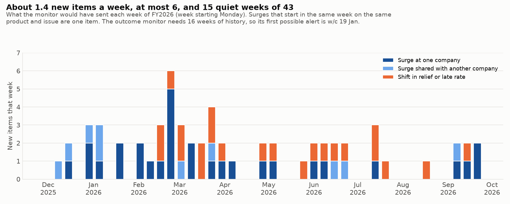
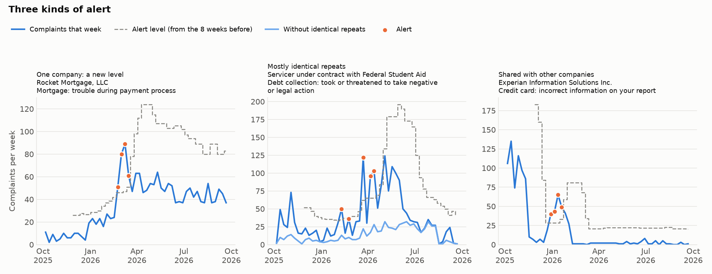
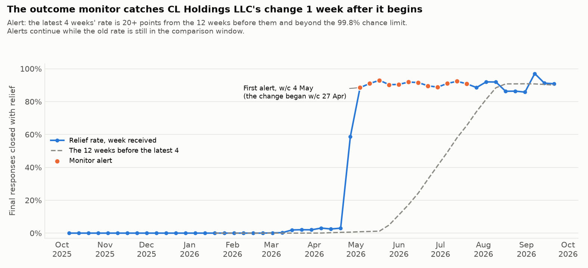

# Part 4: an early-warning monitor

Generated by `scripts/monitor_report.py` from the committed data. Do not edit by hand.

Parts 2 and 3 looked back at the year. This part asks what a complaints or compliance team would have seen **week by week**, if a simple monitor had been running through FY2026. The monitor only uses the weeks before the one it is judging, as it would on the day it runs. It has two parts:

- **Volume:** complaints per week for every **series** (one company, product and issue; 22,346 series). A week alerts when it is at least 2 times the median of the 8 weeks before and at least 20 complaints above it (`sql/monitor_volume.sql`, `complaints/monitor.py`). Consecutive alert weeks are one **episode**. An alert is **shared** when another company alerts on the same product and issue in the same week.
- **Outcomes:** each company's relief rate and late rate in the latest 4 weeks against the 12 weeks before them, for the 415 companies with 100+ final responses. A company alerts when its rate moves by 20 points or more and beyond the 99.8% chance limit, with at least 50 and 100 final responses in the two windows (`sql/monitor_outcomes.sql`).

The backtest runs over the 43 weeks from the week of 1 Dec 2025 to the week of 21 Sep 2026 (the first 8 full weeks of the year only build the baseline; the outcome monitor needs 16 weeks and starts w/c 19 Jan).

## Short answer

- **The workload is small.** Over 43 weeks the monitor would have sent 61 items: 39 volume surges and 22 outcome shifts, about 1.4 a week, never more than 6, with 15 quiet weeks. They concern 39 companies across the whole market; 21 of them would have had a single item all year, and the most for any one company is 5 (CL Holdings LLC).
- **Most surges are one-offs.** Of the 49 volume episodes, 34 fell back below the alert level within 4 weeks, 9 stayed high and 6 are too recent to tell. 12 lasted more than one week. Debt collection has 32 of the 49 episodes and 66% of the extra complaints.
- **24% of the surges do not survive without identical repeat complaints.** Without the repeats Part 1 flagged, 12 of the 49 episodes disappear. In those, 51% of the complaints are repeats, against 6% in the episodes that remain. 4 of them are the entry "Servicer under contract with Federal Student Aid", with 72% to 82% repeats.
- **20 of the 49 episodes are shared with another company.** The three nationwide credit bureaus (Equifax, Experian and TransUnion) account for 9 episodes on just two issues: "incorrect information on your report" filed under credit cards (all three, from late December into January) and "written notification about debt" under debt collection (in January, and all three again in June and July). A shared surge is a different question for a team (something affecting the market or a whole issue) from a surge at one company.
- **The outcome monitor catches step changes within weeks.** It flagged 14 shifts in relief (8 up, 6 down) and 8 in lateness (4 more late, 4 fewer). CL Holdings LLC's change from Part 3 began in the week of 27 Apr 2026 and is flagged the next week. All 4 companies whose relief Part 3 found moving between the two halves of the year are flagged, and the monitor dates each change.
- **Small series need a big surge to alert, by design.** In a series of 20 to 49 complaints a week, an extra week's worth of complaints is caught 51% of the time and twice that 100%; for series under 5 a week, even four weeks' worth extra is caught 1% of the time, because the 20-complaint floor keeps them quiet.

## 1. What would have landed on the desk

Every volume surge and outcome shift is one **item** for a team to look at, except that surges starting in the same week on the same product and issue are sent together. Over the 43 weeks: 29 surges at one company, 10 shared, 22 outcome shifts (`results/monitor_items_per_week.csv`).

| New items in the week | Weeks |
| ---: | ---: |
| 0 | 15 |
| 1 | 6 |
| 2 | 15 |
| 3 | 5 |
| 4 | 1 |
| 6 | 1 |

The volume monitor judged 960,878 series-weeks (553,007 complaints) and alerted on 70 of them, in 38 series at 30 companies.

## 2. Volume surges

- **One company, a new level.** Rocket Mortgage, LLC on mortgage "trouble during payment process" went from a usual 23 a week to 89 at the peak and alerted 4 weeks running from the week of 23 Feb 2026. The median of the 4 weeks after was 55, 2.4 times the old level.
- **Mostly repeats.** The entry "Servicer under contract with Federal Student Aid" alerted on debt collection, "took or threatened to take negative or legal action", in 4 episodes. 72% to 82% of the complaints in them were identical repeats, and without the repeats none of those weeks alerts (section 4).
- **Shared.** The three credit bureaus alerted on the same two issues: credit card "incorrect information on your report": Equifax from the week of 29 Dec 2025 (4 weeks), Experian from the week of 29 Dec 2025 (4 weeks), TransUnion from the week of 5 Jan 2026 (3 weeks); debt collection "written notification about debt": Equifax from the week of 5 Jan 2026 (1 week), TransUnion from the week of 5 Jan 2026 (1 week), Equifax from the week of 15 Jun 2026 (3 weeks), Experian from the week of 22 Jun 2026 (2 weeks), TransUnion from the week of 22 Jun 2026 (1 week), Equifax from the week of 13 Jul 2026 (1 week). Complaints about credit reporting are not in the snapshot (Part 1); these are complaints against the bureaus filed under other products.

**Every volume item** (`results/monitor_volume_items.csv`; episodes with baselines and peaks in `results/monitor_volume_episodes.csv`). "Extra" is complaints above the baseline, summed over the episode; "after" says whether the 4 weeks after the episode stayed at the alert level (hindsight, not used by the monitor):

| Week | Product | Issue | Companies | Weeks | Extra | Shared | After |
| --- | --- | --- | --- | --- | ---: | --- | --- |
| w/c 8 Dec | Debt collection | Took or threatened to take negative or legal action | Bread Financial Holdings, Inc.; CAINE & WEINER COMPANY, INC.; CCS Financial Services, Inc.; TD BANK US HOLDING COMPANY | 1 / 1 / 1 / 1 | 181 | yes | fell back / fell back / fell back / fell back |
| w/c 15 Dec | Debt collection | Took or threatened to take negative or legal action | GOLDMAN SACHS BANK USA; WELLS FARGO & COMPANY | 1 / 1 | 66 | yes | fell back / fell back |
| w/c 15 Dec | Checking or savings | Closing an account | Chime Financial Inc | 1 | 38 |  | fell back |
| w/c 29 Dec | Credit card | Incorrect information on your report | EQUIFAX, INC.; Experian Information Solutions Inc. | 4 / 4 | 279 | yes | fell back / fell back |
| w/c 29 Dec | Money transfer and services | Managing, opening, or closing your mobile wallet account | Paypal Holdings, Inc | 2 | 50 |  | fell back |
| w/c 29 Dec | Money transfer and services | Trouble accessing funds in your mobile or digital wallet | Paypal Holdings, Inc | 1 | 43 |  | fell back |
| w/c 5 Jan | Debt collection | Written notification about debt | EQUIFAX, INC.; TRANSUNION INTERMEDIATE HOLDINGS, INC. | 1 / 1 | 148 | yes | fell back / fell back |
| w/c 5 Jan | Credit card | Incorrect information on your report | TRANSUNION INTERMEDIATE HOLDINGS, INC. | 3 | 98 | yes | fell back |
| w/c 5 Jan | Student loan | Dealing with your lender or servicer | Nelnet, Inc. | 1 | 32 |  | fell back |
| w/c 19 Jan | Checking or savings | Managing an account | Credit Karma, LLC | 1 | 24 |  | stayed high |
| w/c 19 Jan | Debt collection | Attempts to collect debt not owed | National Credit Adjusters, LLC | 1 | 20 |  | fell back |
| w/c 2 Feb | Debt collection | Attempts to collect debt not owed | CL Holdings LLC | 1 | 142 |  | stayed high |
| w/c 2 Feb | Debt collection | False statements or representation | CL Holdings LLC | 1 | 90 |  | fell back |
| w/c 9 Feb | Debt collection | Took or threatened to take negative or legal action | Servicer under contract with Federal Student Aid | 1 | 35 |  | fell back |
| w/c 16 Feb | Checking or savings | Problem caused by your funds being low | NAVY FEDERAL CREDIT UNION | 1 | 51 |  | fell back |
| w/c 23 Feb | Mortgage | Trouble during payment process | Rocket Mortgage, LLC | 4 | 186 |  | stayed high |
| w/c 23 Feb | Money transfer and services | Other transaction problem | Block, Inc. | 2 | 66 |  | fell back |
| w/c 23 Feb | Debt collection | Attempts to collect debt not owed | Harris & Harris, Ltd. | 1 | 30 |  | fell back |
| w/c 23 Feb | Money transfer and services | Money was not available when promised | TClub Inc | 1 | 28 |  | stayed high |
| w/c 23 Feb | Debt collection | Took or threatened to take negative or legal action | Servicer under contract with Federal Student Aid | 1 | 21 |  | stayed high |
| w/c 2 Mar | Debt collection | Attempts to collect debt not owed | CL Holdings LLC; TrueAccord Corp. | 1 / 1 | 287 | yes | fell back / fell back |
| w/c 9 Mar | Money transfer and services | Fraud or scam | Paypal Holdings, Inc | 1 | 34 |  | fell back |
| w/c 9 Mar | Debt collection | Attempts to collect debt not owed | World Acceptance Corporation | 1 | 22 |  | stayed high |
| w/c 23 Mar | Debt collection | Took or threatened to take negative or legal action | Bread Financial Holdings, Inc.; Servicer under contract with Federal Student Aid | 1 / 1 | 130 | yes | stayed high / fell back |
| w/c 23 Mar | Debt collection | Attempts to collect debt not owed | Waypoint Resource Group, LLC | 1 | 22 |  | stayed high |
| w/c 30 Mar | Checking or savings | Problem caused by your funds being low | WELLS FARGO & COMPANY | 1 | 20 |  | fell back |
| w/c 6 Apr | Debt collection | Took or threatened to take negative or legal action | Servicer under contract with Federal Student Aid | 2 | 134 |  | stayed high |
| w/c 27 Apr | Debt collection | Took or threatened to take negative or legal action | Affirm Holdings, Inc | 1 | 22 |  | fell back |
| w/c 4 May | Debt collection | Took or threatened to take negative or legal action | CAPITAL ONE FINANCIAL CORPORATION | 1 | 21 |  | fell back |
| w/c 1 Jun | Debt collection | Attempts to collect debt not owed | United Collection Bureau, Inc. | 1 | 44 |  | fell back |
| w/c 8 Jun | Debt collection | Took or threatened to take negative or legal action | CAPITAL ONE FINANCIAL CORPORATION | 1 | 32 |  | fell back |
| w/c 15 Jun | Debt collection | Written notification about debt | EQUIFAX, INC. | 3 | 98 | yes | fell back |
| w/c 22 Jun | Debt collection | Written notification about debt | Experian Information Solutions Inc.; TRANSUNION INTERMEDIATE HOLDINGS, INC. | 2 / 1 | 250 | yes | fell back / fell back |
| w/c 13 Jul | Debt collection | Written notification about debt | EQUIFAX, INC. | 1 | 27 |  | fell back |
| w/c 7 Sep | Debt collection | False statements or representation | CL Holdings LLC; Resurgent Capital Services L.P. | 3 / 1 | 204 | yes | too recent / too recent |
| w/c 7 Sep | Money transfer and services | Other transaction problem | Block, Inc. | 2 | 45 |  | too recent |
| w/c 14 Sep | Debt collection | Attempts to collect debt not owed | Self Financial Inc. | 2 | 45 |  | too recent |
| w/c 21 Sep | Vehicle loan or lease | Managing the loan or lease | CREDIT ACCEPTANCE CORPORATION | 1 | 37 |  | too recent |
| w/c 21 Sep | Vehicle loan or lease | Repossession | CREDIT ACCEPTANCE CORPORATION | 1 | 22 |  | too recent |

### How the thresholds change the workload

The default is 2 times the baseline and 20+ above it. Looser settings bury a team; tighter ones go quiet for most of the year (`results/monitor_sensitivity.csv`):

| Times the baseline | Complaints above it | Alert weeks | Episodes | Companies | Items | Items a week | Most in a week | Weeks with none |  |
| ---: | ---: | ---: | ---: | ---: | ---: | ---: | ---: | ---: | --- |
| 1.5 | 10 | 629 | 495 | 109 | 277 | 6.4 | 19 | 0 |  |
| 1.5 | 20 | 188 | 129 | 46 | 79 | 1.8 | 7 | 9 |  |
| 2 | 10 | 266 | 219 | 97 | 154 | 3.6 | 11 | 4 |  |
| 2 | 20 | 70 | 49 | 30 | 39 | 0.9 | 5 | 19 | default |
| 2 | 50 | 17 | 14 | 9 | 12 | 0.3 | 2 | 33 |  |
| 3 | 20 | 27 | 20 | 17 | 20 | 0.5 | 2 | 27 |  |
| 3 | 50 | 6 | 5 | 4 | 5 | 0.1 | 1 | 38 |  |

### What size of surge it would catch

For every judged week that did not alert, add a surge of extra complaints worth a multiple of the series' baseline and ask whether the monitor would then alert. Adding to one week leaves its baseline unchanged, so this is exact, not simulated. Series-weeks with a baseline under 1 are left out (`results/monitor_surge_detection.csv`):

| Usual complaints a week | Series-weeks | Series | +0.5x baseline | +1x baseline | +2x baseline | +4x baseline |
| --- | ---: | ---: | ---: | ---: | ---: | ---: |
| 1-4 | 54,985 | 2,990 | 0% | 0% | 0% | 1% |
| 5-9 | 9,086 | 510 | 0% | 0% | 9% | 87% |
| 10-19 | 5,283 | 270 | 2% | 15% | 85% | 100% |
| 20-49 | 3,233 | 140 | 5% | 51% | 100% | 100% |
| 50+ | 1,454 | 52 | 4% | 47% | 100% | 100% |

An extra week's worth is caught only about half the time even in large series, because the rest of that week may have been below its usual level. The floor of 20 extra complaints is what keeps small series quiet: a series with 3 a week would need 23 to alert. That is the intended trade-off for a team watching thousands of series; a team watching its own company could lower the floor for the issues it cares about most.

## 3. Outcome shifts

CL Holdings LLC closed 0.7% of its complaints with relief before the week of 27 Apr 2026, and the monitor alerted from the week of 4 May 2026. Weeks are by date received; in practice an outcome is known only once the company has responded, which the data does not date, so a live alert would come later than this.

**Part 3's four step changes, dated** (relief moved 20+ points between the two halves of the year):

| Company | Oct-Mar relief | Apr-Sep relief | First relief alert |
| --- | ---: | ---: | --- |
| CL Holdings LLC | 0.3% | 76.5% | w/c 4 May |
| T.S. Holdings | 17.3% | 75.5% | w/c 2 Mar |
| CAINE & WEINER COMPANY, INC. | 13.1% | 54.4% | w/c 2 Mar |
| Experian Information Solutions Inc. | 0.3% | 21.4% | w/c 8 Jun |

**Every outcome shift** (`results/monitor_outcome_episodes.csv`). "Before" is the 12 weeks before the latest 4; the rates are from the first alert week:

| First week | Company | Change | Before | Latest 4 weeks | Move | Responses (latest 4 weeks) | Weeks alerting |
| --- | --- | --- | ---: | ---: | ---: | ---: | ---: |
| w/c 16 Feb | ProCollect, Inc. | fewer late | 27.5% | 5.6% | −21.9 pts | 125 | 3 |
| w/c 16 Feb | Credit Karma, LLC | less relief | 58.3% | 31.1% | −27.2 pts | 90 | 1 |
| w/c 23 Feb | TRANSUNION INTERMEDIATE HOLDINGS, INC. | less relief | 58.9% | 38.8% | −20.1 pts | 1,146 | 1 |
| w/c 2 Mar | CAINE & WEINER COMPANY, INC. | more relief | 0.2% | 23.4% | +23.2 pts | 530 | 11 |
| w/c 2 Mar | T.S. Holdings | more relief | 1.5% | 33.9% | +32.4 pts | 245 | 10 |
| w/c 16 Mar | Bilt Technologies, Inc. | fewer late | 94.5% | 12.4% | −82.1 pts | 121 | 10 |
| w/c 16 Mar | EQUIFAX, INC. | less relief | 51.2% | 30.7% | −20.5 pts | 907 | 1 |
| w/c 23 Mar | FinCo Services Inc DBA Current | more late | 7.4% | 34.2% | +26.8 pts | 79 | 4 |
| w/c 23 Mar | World Acceptance Corporation | less relief | 39.8% | 14.0% | −25.8 pts | 143 | 2 |
| w/c 30 Mar | Solar Mosaic LLC | fewer late | 47.5% | 13.7% | −33.8 pts | 51 | 1 |
| w/c 27 Apr | Solar Mosaic LLC | more late | 26.0% | 75.0% | +49.0 pts | 56 | 3 |
| w/c 4 May | CL Holdings LLC | more relief | 0.9% | 37.7% | +36.9 pts | 1,921 | 12 |
| w/c 25 May | Waypoint Resource Group, LLC | more late | 13.7% | 46.6% | +32.9 pts | 116 | 6 |
| w/c 1 Jun | Shellpoint Partners, LLC | more late | 3.4% | 27.8% | +24.4 pts | 299 | 7 |
| w/c 8 Jun | Experian Information Solutions Inc. | more relief | 0.7% | 20.8% | +20.1 pts | 717 | 7 |
| w/c 15 Jun | Spring Oaks Capital, LLC | less relief | 70.6% | 48.7% | −21.8 pts | 394 | 3 |
| w/c 22 Jun | T.S. Holdings | more relief | 54.7% | 75.0% | +20.3 pts | 172 | 7 |
| w/c 13 Jul | Waypoint Resource Group, LLC | fewer late | 37.5% | 14.6% | −23.0 pts | 103 | 7 |
| w/c 13 Jul | PENTAGON FEDERAL CREDIT UNION | more relief | 11.5% | 44.4% | +32.9 pts | 54 | 3 |
| w/c 20 Jul | CCF Intermediate Holdings LLC | more relief | 0.0% | 20.8% | +20.8 pts | 53 | 3 |
| w/c 17 Aug | T.S. Holdings | more relief | 72.6% | 94.5% | +21.8 pts | 145 | 1 |
| w/c 14 Sep | Harris & Harris, Ltd. | less relief | 28.4% | 4.2% | −24.2 pts | 118 | 2 |

Shifts go both ways. 4 companies became late more often. That is the clearest alert, since the CFPB flags timeliness the same way for everyone. Bilt Technologies, Inc. went the other way, from 94% late to 12%. A relief shift says that a company closes complaints differently, or records them differently; the data cannot say which (Part 3).

## 4. Repeats: de-duplicate before alerting

Part 1 found 17,349 complaints identical to an earlier one on every field except the ID; 16,984 of them fall in these weeks. They are 2.6% of the complaints in these weeks but 13.4% of the complaints in alert weeks. Rerunning the volume monitor without them, 37 of the 49 episodes still alert in at least one of their weeks and 12 do not (`results/monitor_repeat_driven_episodes.csv`):

| Week | Company | Product | Issue | Complaints | Repeats | Repeat share |
| --- | --- | --- | --- | --- | ---: | ---: |
| w/c 8 Dec | CCS Financial Services, Inc. | Debt collection | Took or threatened to take negative or legal action | 92 | 16 | 17% |
| w/c 19 Jan | National Credit Adjusters, LLC | Debt collection | Attempts to collect debt not owed | 37 | 1 | 3% |
| w/c 9 Feb | Servicer under contract with Federal Student Aid | Debt collection | Took or threatened to take negative or legal action | 50 | 37 | 74% |
| w/c 23 Feb | Servicer under contract with Federal Student Aid | Debt collection | Took or threatened to take negative or legal action | 36 | 26 | 72% |
| w/c 9 Mar | Paypal Holdings, Inc | Money transfer and services | Fraud or scam | 65 | 36 | 55% |
| w/c 9 Mar | World Acceptance Corporation | Debt collection | Attempts to collect debt not owed | 29 | 4 | 14% |
| w/c 23 Mar | Servicer under contract with Federal Student Aid | Debt collection | Took or threatened to take negative or legal action | 122 | 100 | 82% |
| w/c 23 Mar | Bread Financial Holdings, Inc. | Debt collection | Took or threatened to take negative or legal action | 73 | 24 | 33% |
| w/c 6 Apr | Servicer under contract with Federal Student Aid | Debt collection | Took or threatened to take negative or legal action | 199 | 154 | 77% |
| w/c 27 Apr | Affirm Holdings, Inc | Debt collection | Took or threatened to take negative or legal action | 41 | 8 | 20% |
| w/c 1 Jun | United Collection Bureau, Inc. | Debt collection | Attempts to collect debt not owed | 47 | 25 | 53% |
| w/c 13 Jul | EQUIFAX, INC. | Debt collection | Written notification about debt | 54 | 3 | 6% |

Without the repeats the monitor finds 39 episodes in all. A repeat can be a consumer filing the same complaint twice, or a batch filed for several consumers; the data cannot tell which. For a team the answer is the same: count each distinct complaint once before alerting.

## So what for a complaints or compliance team

1. **A weekly monitor is cheap to run and to staff.** On this rule the whole market produced about 1.4 items a week, and no single company had more than 5 all year. Run it on the company's own complaints (and on the CFPB's public data, to see the market).
2. **Strip identical repeats first.** 12 of the 49 surges here did not survive without them; leaving them in would send a team chasing duplicates.
3. **Ask whether a surge is shared.** When competitors alert on the same issue the same week, look for a common cause (a market event, an industry-wide change, a filing campaign) before treating it as your own service failure.
4. **Expect most surges to fall back, and watch the ones that don't.** 37 of the 49 episodes lasted one week; the few that stayed high (like Rocket Mortgage's payment-process complaints) are the ones that need a root-cause review.
5. **Monitor outcomes, not only volumes.** A step change in relief or lateness is invisible in complaint counts. The outcome monitor found every change Part 3 found, and dated it.
6. **Tune the thresholds to the team, not to the data.** The table in section 2 shows the trade-off: from 6.4 items a week at the loosest setting tried to 0.1 at the tightest.

## Limits

- One fiscal year. The monitor needs 8 weeks of history before it can judge a week (and the outcome monitor 16), so the backtest covers 43 weeks, and the last 4 weeks' episodes cannot yet be called one-offs or new levels.
- Weeks are by date received. A live monitor sees a complaint only once the CFPB publishes it, and an outcome only once the company responds; the data has no publication or response date, so the delay cannot be measured here.
- There is no list of real incidents to score the alerts against, so the backtest measures workload and what size of surge would be caught, not how many alerts were "right".
- The issue is the consumer's choice from the CFPB's list, and the same problem can be filed under different issues or products (the credit bureaus' complaints above are one example).
- A rule this simple ignores weekly seasonality such as holidays; with one year of data there is no earlier year to learn it from.
