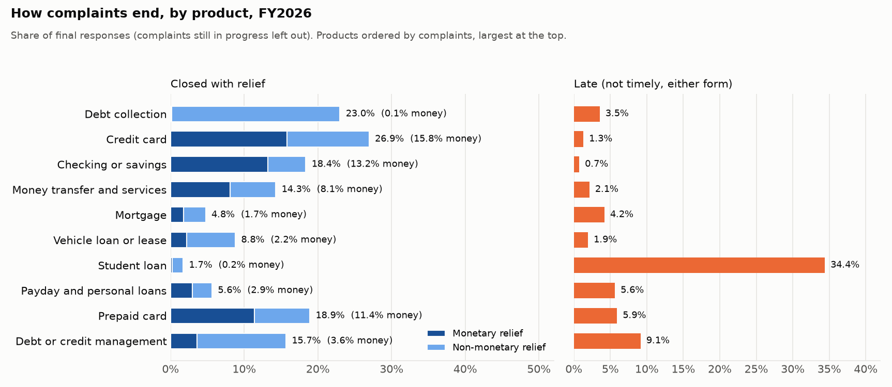
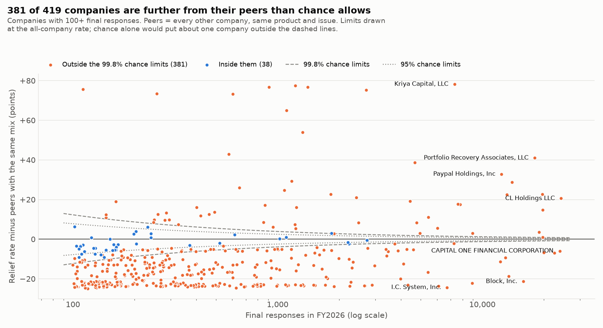
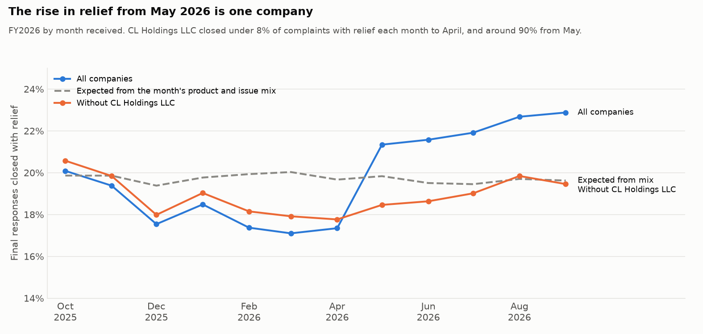
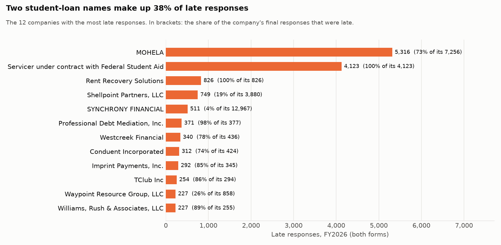

# Part 3: how companies respond

Generated by `scripts/response_report.py` from the committed data. Do not edit by hand.

## Short answer

- **One complaint in five ends with relief, and what counts as relief depends on the product.** Of 656,700 final responses, 19.7% were closed with relief, 5.0% with money. Credit cards (26.9%) and debt collection (23.0%) are highest, but in debt collection almost all of it is non-monetary (0.1% money).
- **Companies differ far more than chance allows, even against peers with the same products and issues.** 381 of the 419 companies with 100+ final responses are outside the 99.8% chance limits on relief (chance alone would put about 1 there): 325 below their peers and 56 above. Allowing for mix barely narrows the gap: the average distance from the benchmark goes from 18.6 to 17.0 points.
- **In debt collection, relief looks like a recording habit as much as an outcome.** 190 of 259 collectors with 100+ final responses closed under 2% of complaints with relief and 8 closed over 90%. On the same issue ("attempts to collect debt not owed") 85 of 136 collectors are under 2% and 8 are over 90%.
- **The rise in relief during the year is one company changing how it closes complaints.** The relief rate went from 18.3% (October to March) to 21.2% (April to September). CL Holdings LLC closed 1.5% of its complaints with relief up to April and 90.4% from May; without it the rate goes from 18.9% to 18.8%. 4 companies with 250+ responses in each half moved by 20 points or more, all of them upwards.
- **Late responses are a few companies' problem.** 3.8% of final responses were late (24,673). 8 companies make up half of them, and two names linked to student loans make up 38%: MOHELA (73% of its 7,256 final responses late) and the entry "Servicer under contract with Federal Student Aid" (100% of 4,123). 181 of the 419 large companies were never late.
- **The repeats change nothing.** Without the identical repeat complaints, 417 of 418 companies keep the same verdict against their peers.

## 1. How complaints end, by product

Outcomes are read on **final responses** only: 1,743 complaints were still in progress at the snapshot (1,275 of them received in September 2026) and are left out. An "Untimely response" is final: the company did not respond in time, so it counts as no relief. **Late** counts both forms of not timely from Part 1: the untimely responses and responses that were closed but flagged as not timely (`sql/responses.sql`).

| Product | Final responses | Relief | of which money | Explanation only | Late | Untimely response | Closed late | Companies |
| --- | ---: | ---: | ---: | ---: | ---: | ---: | ---: | ---: |
| Debt collection | 324,305 | 23.0% | 0.1% | 74.7% | 3.5% | 7,344 | 4,097 | 2,822 |
| Credit card | 95,984 | 26.9% | 15.8% | 72.9% | 1.3% | 159 | 1,076 | 554 |
| Checking or savings | 88,778 | 18.4% | 13.2% | 81.5% | 0.7% | 144 | 493 | 508 |
| Money transfer and services | 39,521 | 14.3% | 8.1% | 85.2% | 2.1% | 193 | 643 | 485 |
| Mortgage | 33,402 | 4.8% | 1.7% | 93.5% | 4.2% | 572 | 822 | 849 |
| Vehicle loan or lease | 25,410 | 8.8% | 2.2% | 90.6% | 1.9% | 153 | 335 | 585 |
| Student loan | 19,830 | 1.7% | 0.2% | 68.0% | 34.4% | 6,010 | 806 | 173 |
| Payday and personal loans | 18,656 | 5.6% | 2.9% | 92.9% | 5.6% | 280 | 766 | 814 |
| Prepaid card | 6,422 | 18.9% | 11.4% | 80.5% | 5.9% | 40 | 339 | 143 |
| Debt or credit management | 4,392 | 15.7% | 3.6% | 79.7% | 9.1% | 203 | 198 | 617 |

**All products:** 656,700 final responses, relief 19.7%, money 5.0%, late 3.8% (15,098 untimely responses + 9,575 closed late). Relief is not the same thing in every product: for credit cards 59% of relief is monetary and for bank accounts 72%, while in debt collection almost none is (428 of 74,581), so the product rates are not one scale. Student loans have the lowest relief (1.7%) and by far the most late responses (34.4%; section 4).

## 2. Companies against their peers

**Method** (`sql/company_expected.sql`). A company's raw relief rate says as much about what it is complained about as about how it responds, so each company is compared with an **expected** rate: for every one of its complaints, the relief rate of all *other* companies on the same product and issue (if those peers have fewer than 30 final responses on it, the product's rate without the company is used). Leaving the company out matters: several companies are a large share of their own cells. The chance limits are the usual funnel-plot ones: how far from the expected count a company would land by chance alone if it handled complaints like its peers (binomial variance). Only the 419 companies with 100+ final responses are compared; they have 618,627 of the 656,700 final responses.

- **Chance explains almost none of the spread.** 381 of 419 companies are outside the 99.8% limits (399 outside the 95% limits), against about 0.8 and 21 by chance. On **monetary** relief (`results/monetary_relief_against_peers.csv`) 144 are outside the 99.8% limits, 111 below and 33 above.
- **Most companies sit below their peers, a few far above.** 325 are below the limits and 56 above. Peer rates pool all other companies' responses, so large companies with high relief rates weigh heavily in them, and the typical company falls below.
- **Mix changes little.** The average distance from the benchmark is 18.6 points on raw rates and 17.0 after allowing for product and issue (1.6 points less). It changes the direction for 6 companies: 5+ points below the all-company rate on raw figures, but above peers with the same mix. By main product: mortgage (3), student loan (2), payday and personal loans (1). Relief is rare for everyone in these products:

| Company | Main product | Final responses | Relief | All companies | Peers, same mix | Against chance limits |
| --- | --- | ---: | ---: | ---: | ---: | --- |
| PENNYMAC LOAN SERVICES, LLC. | Mortgage | 1,214 | 13.3% | 19.7% | 5.9% | above |
| SLM CORPORATION | Student loan | 853 | 13.4% | 19.7% | 4.8% | above |
| AmeriHome Mortgage Company, LLC | Mortgage | 295 | 14.6% | 19.7% | 4.7% | above |
| AES/PHEAA | Student loan | 248 | 12.9% | 19.7% | 4.5% | above |
| SERVICEMAC, LLC | Mortgage | 241 | 7.5% | 19.7% | 4.6% | within |
| GREENSKY OPERATIONS, LLC | Payday and personal loans | 198 | 14.1% | 19.7% | 11.5% | within |

**The 10 companies with the most final responses** (10 of 10 outside the 99.8% limits):

| Company | Main product | Final responses | Relief | Peers, same mix | Difference | Against chance limits |
| --- | --- | ---: | ---: | ---: | ---: | --- |
| CL Holdings LLC | Debt collection | 24,229 | 42.5% | 21.9% | +20.6 pts | above |
| CAPITAL ONE FINANCIAL CORPORATION | Credit card | 23,874 | 17.5% | 23.4% | −5.9 pts | below |
| JPMORGAN CHASE & CO. | Checking or savings | 22,505 | 13.8% | 20.6% | −6.9 pts | below |
| ENCORE CAPITAL GROUP INC. | Debt collection | 19,980 | 16.6% | 23.4% | −6.8 pts | below |
| WELLS FARGO & COMPANY | Checking or savings | 19,745 | 19.6% | 18.6% | +1.0 pts | above |
| BANK OF AMERICA, NATIONAL ASSOCIATION | Checking or savings | 19,742 | 33.5% | 18.7% | +14.9 pts | above |
| CITIBANK, N.A. | Credit card | 19,605 | 44.6% | 21.9% | +22.7 pts | above |
| Resurgent Capital Services L.P. | Debt collection | 18,917 | 26.0% | 22.4% | +3.6 pts | above |
| Portfolio Recovery Associates, LLC | Debt collection | 18,018 | 61.8% | 20.7% | +41.0 pts | above |
| Block, Inc. | Money transfer and services | 15,869 | 0.2% | 21.5% | −21.3 pts | below |

Every company is in `results/relief_against_peers.csv` (observed, expected, z-score and verdict). For example, Capital One closed 17.5% of complaints with relief against 23.4% for peers with its mix, and Citibank 44.6% against 21.9%.

### Why the spread is so wide: relief is recorded differently

Within one product, many companies almost never record relief and a few almost always do (companies with 100+ final responses in the product; `results/relief_spread_by_product.csv`):

| Product | Companies | Under 2% relief | Over 90% | Median company | Middle half of companies | All their responses |
| --- | ---: | ---: | ---: | ---: | ---: | ---: |
| Debt collection | 259 | 190 | 8 | 0.0% | 0.0% to 2.9% | 24.8% |
| Credit card | 50 | 9 | 0 | 18.8% | 5.0% to 27.6% | 27.6% |
| Checking or savings | 63 | 19 | 0 | 8.5% | 0.7% to 23.5% | 18.9% |
| Money transfer and services | 32 | 11 | 0 | 7.3% | 0.0% to 12.9% | 14.9% |
| Mortgage | 48 | 28 | 0 | 0.4% | 0.0% to 12.1% | 4.6% |
| Vehicle loan or lease | 45 | 21 | 0 | 3.9% | 0.0% to 14.1% | 9.1% |
| Student loan | 12 | 9 | 0 | 0.0% | 0.0% to 2.3% | 0.9% |
| Payday and personal loans | 41 | 21 | 0 | 1.7% | 0.0% to 8.3% | 4.5% |
| Prepaid card | 14 | 7 | 0 | 2.3% | 0.0% to 31.3% | 19.8% |
| Debt or credit management | 6 | 2 | 0 | 17.3% | 2.2% to 32.5% | 21.9% |

The clearest case is debt collection on a single issue, "Attempts to collect debt not owed": of the 136 collectors with 100+ final responses on it, 85 closed under 2% with relief and 8 over 90%, for the same complaint chosen from the same list. The data cannot say whether these companies treat consumers that differently or record the same kind of answer under different labels (for example, whether stopping collection on a disputed debt is logged as relief or as an explanation). Either way, **a company's relief rate is only comparable with its own history** unless the labelling rules are known, which is why section 3 looks for changes within a company.

## 3. Changes during the year

The relief rate rose from 18.3% in the first half of FY2026 (October to March) to 21.2% in the second (April to September), while the rate expected from each month's product and issue mix stayed between 19.4% and 20.0%. So the rise is not a change in what people complained about. Splitting the change by company (`sql/relief_halves.sql`; the contributions add up exactly to the change), **CL Holdings LLC** makes up +3.2 pts of the +3.0 pts: more than all of it.

| Month received | Final responses | Closed with relief | Relief rate |
| --- | ---: | ---: | ---: |
| Oct 2025 | 1,190 | 0 | 0.0% |
| Nov 2025 | 1,132 | 0 | 0.0% |
| Dec 2025 | 1,409 | 0 | 0.0% |
| Jan 2026 | 1,790 | 0 | 0.0% |
| Feb 2026 | 2,246 | 0 | 0.0% |
| Mar 2026 | 3,050 | 34 | 1.1% |
| Apr 2026 | 2,242 | 160 | 7.1% |
| May 2026 | 2,193 | 1,994 | 90.9% |
| Jun 2026 | 2,239 | 2,037 | 91.0% |
| Jul 2026 | 2,231 | 2,011 | 90.1% |
| Aug 2026 | 2,094 | 1,850 | 88.3% |
| Sep 2026 | 2,413 | 2,204 | 91.3% |

99% of CL Holdings LLC's complaints are about debt collection. It closed every complaint received from Oct 2025 to Feb 2026 without relief, then between 88% and 91% with relief in every month from May 2026, all of it non-monetary (none with money all year). Without it, the all-company rate goes from 18.9% to 18.8%. The data does not say what changed: a new way of handling these complaints, or a new way of recording the same answers.

**Companies that changed** (250+ final responses in each half, relief rate moved by 20 points or more, beyond the 99.8% chance limit; `results/relief_by_half.csv`):

| Company | Oct-Mar responses | Oct-Mar relief | Apr-Sep responses | Apr-Sep relief | Change |
| --- | ---: | ---: | ---: | ---: | ---: |
| CL Holdings LLC | 10,817 | 0.3% | 13,412 | 76.5% | +76.2 pts |
| T.S. Holdings | 1,311 | 17.3% | 1,109 | 75.5% | +58.2 pts |
| CAINE & WEINER COMPANY, INC. | 2,630 | 13.1% | 2,814 | 54.4% | +41.3 pts |
| Experian Information Solutions Inc. | 8,753 | 0.3% | 4,696 | 21.4% | +21.1 pts |

For a compliance team this is the use of the data that holds up: **a step change in a company's own outcome mix** is either a real change in how complaints are handled or a change in how they are recorded, and both are worth knowing about. Part 4 turns this into a monitor.

## 4. Timeliness

Timeliness is the CFPB's own yes/no flag ("Timely response?"), recorded the same way for every product and company, so lateness is compared directly, with no allowance for mix (`sql/late_by_company.sql`). 24,673 final responses were late (3.8%), at 1,834 of 3,975 companies.

- **It is concentrated.** 8 companies make up half of all late responses and 127 make up 80%. MOHELA alone is 22%: 5,316 of its 7,256 final responses were late (4,592 untimely responses, 724 closed late).
- **"Servicer under contract with Federal Student Aid" was late on all 4,123 of its final responses**, every one an untimely response. The entry names no company. Most of its complaints are debt collection with sub-product "I do not know" (2,308) and student loan with sub-product "Federal student loan servicing" (1,547), out of 4,123.
- **Student loans are late because of those two.** Without them, 1.2% of student-loan final responses were late, against 34.4% with them.
- **Most large companies are rarely late.** Of the 419 companies with 100+ final responses, 181 were never late and 40 were late on 10% or more.

The 15 of these 40 with the most late responses (all of them are in `results/late_by_company.csv`):

| Company | Main product | Final responses | Late | Late rate | of which untimely response |
| --- | --- | ---: | ---: | ---: | ---: |
| MOHELA | Student loan | 7,256 | 5,316 | 73% | 4,592 |
| Servicer under contract with Federal Student Aid | Debt collection | 4,123 | 4,123 | 100% | 4,123 |
| Rent Recovery Solutions | Debt collection | 826 | 826 | 100% | 826 |
| Shellpoint Partners, LLC | Mortgage | 3,880 | 749 | 19% | 270 |
| Professional Debt Mediation, Inc. | Debt collection | 377 | 371 | 98% | 73 |
| Westcreek Financial | Debt collection | 436 | 340 | 78% | 0 |
| Conduent Incorporated | Prepaid card | 424 | 312 | 74% | 21 |
| Imprint Payments, Inc. | Credit card | 345 | 292 | 85% | 47 |
| TClub Inc | Money transfer and services | 294 | 254 | 86% | 35 |
| Waypoint Resource Group, LLC | Debt collection | 858 | 227 | 26% | 0 |
| Williams, Rush & Associates, LLC | Debt collection | 255 | 227 | 89% | 196 |
| FinCo Services Inc DBA Current | Checking or savings | 1,022 | 210 | 21% | 8 |
| Professional Recovery Management | Debt collection | 316 | 203 | 64% | 0 |
| Solar Mosaic LLC | Payday and personal loans | 344 | 166 | 48% | 0 |
| ProCollect, Inc. | Debt collection | 1,501 | 152 | 10% | 0 |

## 5. Do the repeats change anything?

Part 1 found 17,349 complaints identical to an earlier one on every field except the ID. Rerunning the peer comparison without them (`where = NOT is_repeat`): 417 of 418 companies keep the same verdict (HW Holding, Inc: within → above), the differences from peers correlate at 0.9999, and no company's difference moves by more than 2.8 points.

## So what for a complaints or compliance team

1. **Don't benchmark your relief rate against other companies' published rates** without knowing how they record relief: on the same product and issue, collectors range from almost never to almost always. Benchmark against your own history, and against peers only on outcomes with a shared definition (timeliness, which the CFPB flags the same way for everyone).
2. **Allow for mix anyway, then look at the size of the gap.** It moves the average gap by only 1.6 points, but for mortgage, student-loan and personal-loan companies, where relief is rare, it can turn "below average" into "above peers".
3. **Watch for step changes in your own outcome mix.** One collector's change moved the relief rate across all companies by +3.2 pts between the two halves of the year; a change like that in your own data needs an explanation before it reaches a board report.
4. **Timeliness is the clean comparison.** The CFPB flags it the same way for everyone, most large companies are rarely late, and the misses sit with a handful of firms, led by student-loan servicing.

## Limits

- Relief and explanation are the company's own description of its response; the CFPB does not verify them, and consumers' feedback on responses is not published.
- Expected rates use product and issue only; sub-product, state or how the complaint was submitted could also differ between companies. The fallback to product level covers few responses (231 of 618,627).
- The chance limits assume complaints are independent; repeats and campaigns make them less so, which would widen the limits. The median company outside the 99.8% limits is 7.6 standard deviations from its expected count, against 3.1 at the limit.
- Outcomes for the last months are those already final at the snapshot; responses still in progress (most from September 2026) may end differently.
