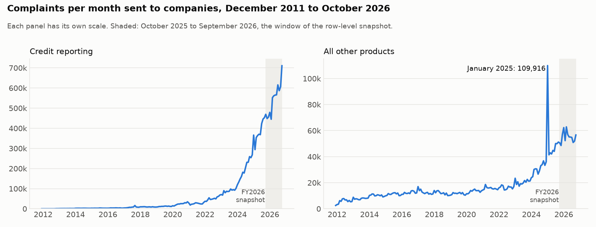
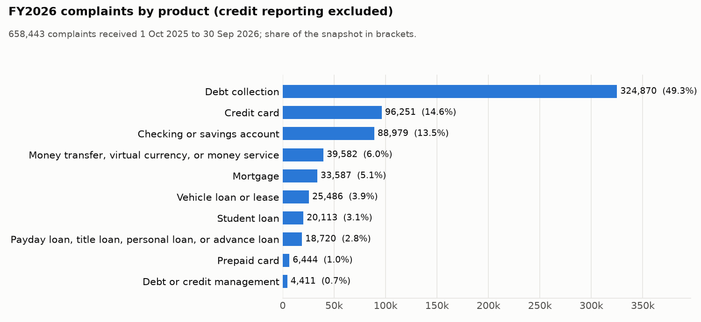
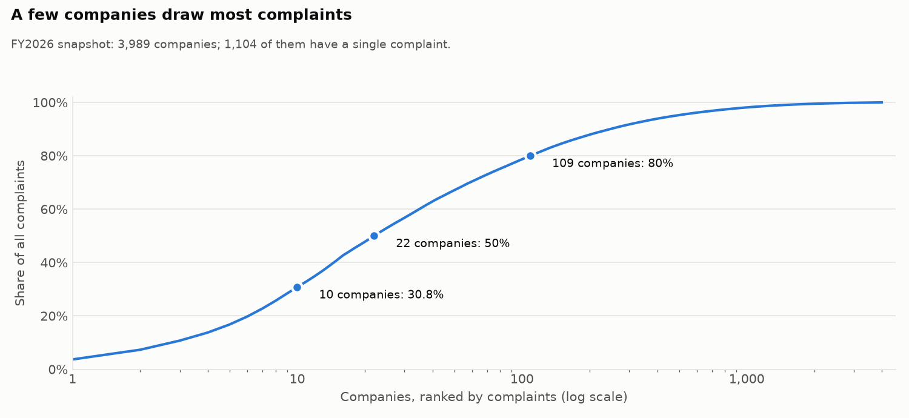
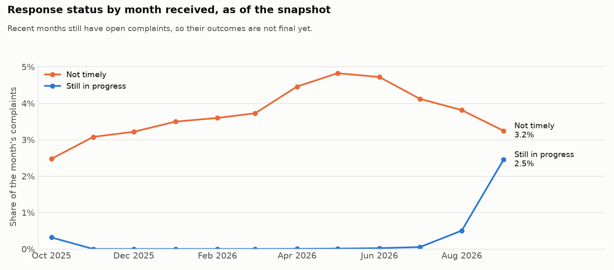

# Part 1: source, snapshot and data profile

Generated by `scripts/profile_report.py` from the committed snapshot. Do not edit by hand.

## Short answer

- **The database grew 26-fold in seven years, and credit reporting is most of it.** Complaints rose from 266,751 in FY2019 to 7,007,745 in FY2026 (US federal fiscal years, October to September); credit reporting went from 48.5% to 90.6% of them. Every other product together went from 137,421 to 658,443.
- **The row-level snapshot is the 658,443 FY2026 complaints about everything except credit reporting.** Debt collection is 49.3% of them; credit cards and bank accounts are next.
- **Complaints are concentrated.** The 10 most-complained-about companies draw 30.8% of complaints, 22 companies draw half, and 1,104 of 3,989 companies have one complaint each.
- **The data is clean where it matters, with five traps to handle before analysis:** 1,743 complaints are still in progress (1,275 of them from September 2026); "not timely" has two forms (15,098 with no response in time, 9,575 closed late); 17,349 complaints (2.6%) are identical to an earlier one on every field except the ID, 85% of them in debt collection; 4 companies appear under two spellings; and ZIP codes are masked for small areas by design.
- **There is no free text.** The CFPB removed consumers' complaint narratives in September 2026, so every finding in this project comes from the 15 structured fields.

## 1. The source

- **Consumer Complaint Database**, US Consumer Financial Protection Bureau (CFPB): <https://www.consumerfinance.gov/data-research/consumer-complaints/>. A US Government work, in the public domain in the United States; no key or sign-up.
- Bulk file `https://files.consumerfinance.gov/ccdb/complaints.csv.zip`, dated Tue, 24 Nov 2026 10:17:17 GMT, 371,218,594 bytes zipped, SHA-256 `8b6db08e0f2d3c7a…`, 19,397,176 complaints from December 2011 to 23 November 2026, 15 columns (field definitions: <https://cfpb.github.io/api/ccdb/fields.html>).
- Two 2026 changes (<https://cfpb.github.io/api/ccdb/release-notes.html>): narratives removed (Release 24, September 2026), and filtered CSV exports from the API capped at 100,000 complaints (Release 23, July 2026). That is why this project uses the full bulk file and not the API.
- What the CFPB says about the data: only complaints sent to companies for a response are published; complaints referred to other regulators (for example about banks and credit unions with under $10 billion in assets) are not; it is "not a statistical sample of consumers' experiences"; and volumes should be read against company size and market share.

Committed files (SHA-256 pinned in `complaints/source.py`; `python scripts/download_data.py` checks them):

| File | What | Rows |
| --- | --- | ---: |
| `data/complaints_fy2026.parquet` | one row per complaint, FY2026, all products except credit reporting | 658,443 |
| `data/monthly_by_product.csv` | complaints per month and product (as named when filed), full history | 1,711 |

The monthly file adds up to 19,397,176 complaints, the whole bulk file.

## 2. Fifteen years of complaints

| Fiscal year | All complaints | Credit reporting | Share | All other products |
| --- | ---: | ---: | ---: | ---: |
| FY2019 | 266,751 | 129,330 | 48.5% | 137,421 |
| FY2020 | 380,283 | 226,593 | 59.6% | 153,690 |
| FY2021 | 505,539 | 322,083 | 63.7% | 183,456 |
| FY2022 | 686,561 | 494,116 | 72.0% | 192,445 |
| FY2023 | 1,176,171 | 947,074 | 80.5% | 229,097 |
| FY2024 | 2,201,170 | 1,873,631 | 85.1% | 327,539 |
| FY2025 | 4,800,953 | 4,218,343 | 87.9% | 582,610 |
| FY2026 | 7,007,745 | 6,349,302 | 90.6% | 658,443 |

FY2012 to FY2018 and the part year FY2027 are in `results/history_by_fiscal_year.csv`. Credit-reporting complaints grew 49-fold from FY2019 to FY2026, and all other products 4.8-fold. The data does not say why. This project keeps credit reporting out of the row-level snapshot: it is a different kind of complaint (about consumer reports, not a product the consumer chose), and at 6.3 million rows in FY2026 it would swamp every other product.

The tall spike in the right-hand panel is January 2025, outside the snapshot: 109,916 complaints about products other than credit reporting, against 36,058 the month before and 41,402 the month after. Most of it is money transfers (49,743 against 1,731 the month before) and checking or savings accounts (18,367 against 4,798). The data does not say why. A month like this can swamp a trend, so Part 2 looks for such surges before reading any.

Product names changed over the years: the history has 21 names, the FY2026 snapshot 10 (plus credit reporting). Part 2 maps old names onto current ones before comparing years.

## 3. The FY2026 snapshot: products and companies

| Product | Complaints | Share | Companies |
| --- | ---: | ---: | ---: |
| Debt collection | 324,870 | 49.3% | 2,827 |
| Credit card | 96,251 | 14.6% | 555 |
| Checking or savings account | 88,979 | 13.5% | 509 |
| Money transfer, virtual currency, or money service | 39,582 | 6.0% | 486 |
| Mortgage | 33,587 | 5.1% | 857 |
| Vehicle loan or lease | 25,486 | 3.9% | 586 |
| Student loan | 20,113 | 3.1% | 174 |
| Payday loan, title loan, personal loan, or advance loan | 18,720 | 2.8% | 816 |
| Prepaid card | 6,444 | 1.0% | 143 |
| Debt or credit management | 4,411 | 0.7% | 621 |

| Rank | Company | Complaints | Running share |
| ---: | --- | ---: | ---: |
| 1 | CL Holdings LLC | 24,233 | 3.7% |
| 2 | CAPITAL ONE FINANCIAL CORPORATION | 23,892 | 7.3% |
| 3 | JPMORGAN CHASE & CO. | 22,512 | 10.7% |
| 4 | ENCORE CAPITAL GROUP INC. | 20,002 | 13.8% |
| 5 | BANK OF AMERICA, NATIONAL ASSOCIATION | 19,835 | 16.8% |
| 6 | WELLS FARGO & COMPANY | 19,759 | 19.8% |
| 7 | CITIBANK, N.A. | 19,621 | 22.8% |
| 8 | Resurgent Capital Services L.P. | 18,918 | 25.6% |
| 9 | Portfolio Recovery Associates, LLC | 18,040 | 28.4% |
| 10 | Block, Inc. | 15,889 | 30.8% |

These are raw counts. Large companies have more customers, and the data has no customer counts, so a high rank is not by itself a sign of worse service. Part 3 compares companies on how they respond (shares of complaints closed with relief or answered in time), which are rates and so less tied to size.

## 4. Column profile

| Column | Filled | Distinct | Most common value | Its share |
| --- | ---: | ---: | --- | ---: |
| `complaint_id` | 100.0% | 658,443 | (every value unique) |  |
| `date_received` | 100.0% | 365 | 2026-03-10 | 0.4% |
| `date_sent_to_company` | 100.0% | 410 | 2025-12-09 | 0.6% |
| `product` | 100.0% | 10 | Debt collection | 49.3% |
| `sub_product` | 100.0% | 53 | I do not know | 31.1% |
| `issue` | 100.0% | 88 | Attempts to collect debt not owed | 21.4% |
| `sub_issue` | 90.6% | 208 | Debt is not yours | 15.1% |
| `company` | 100.0% | 3,989 | CL Holdings LLC | 3.7% |
| `state` | 99.5% | 61 | TX | 13.4% |
| `zip_code` | 99.7% | 20,391 | XXXXX | 1.0% |
| `tags` | 10.9% | 3 | Servicemember | 55.3% |
| `submitted_via` | 100.0% | 4 | Web | 95.8% |
| `company_response` | 100.0% | 5 | Closed with explanation | 77.8% |
| `company_public_response` | 31.0% | 10 | Company has responded to the consumer and the CFPB and choos… | 81.6% |
| `timely_response` | 100.0% | 2 | Yes | 96.3% |

Shares of the most common value are of filled rows. `tags` and `company_public_response` are empty by design when there is no tag or the company chose not to publish a response.

## 5. Data-quality checks

Nothing is removed here: each check counts complaints, and the last column says how later parts handle it (`sql/quality_checks.sql`).

| # | Check | Complaints | Share | What it means |
| ---: | --- | ---: | ---: | --- |
| 1 | Complaint ID is not unique | 0 | 0.00% | Each row is one complaint. |
| 2 | Date received outside the window | 0 | 0.00% | The snapshot holds the window and nothing else. |
| 3 | Sent to the company before it was received | 0 | 0.00% | Dates are consistent. |
| 4 | Sent to the company more than 14 days after it was received | 33,403 | 5.07% | Time spent at the CFPB, before the company sees the complaint: not the company's delay. |
| 5 | Timely response is not Yes or No | 0 | 0.00% | Timeliness can be read on every complaint. |
| 6 | Company response still "In progress" | 1,743 | 0.26% | Outcome not final yet: leave these out of response-rate figures, or wait. |
| 7 | Not timely: "Untimely response" (no response in time) | 15,098 | 2.29% | The company did not respond in time. |
| 8 | Not timely: closed, but late | 9,575 | 1.45% | The company closed the complaint, but late. Count both kinds when measuring timeliness. |
| 9 | "Untimely response" marked as timely | 0 | 0.00% | The two fields agree. |
| 10 | State missing | 3,547 | 0.54% | Leave out of state-level figures, or report as 'unknown'. |
| 11 | State not a two-letter code | 50 | 0.01% | The full name UNITED STATES MINOR OUTLYING ISLANDS, not a code. Map it before grouping. |
| 12 | ZIP code published as 3 digits only (small area) | 66,485 | 10.10% | Published rule: the 5-digit ZIP is hidden where the ZIP area has under 20,000 people. |
| 13 | ZIP code withheld (XXXXX) | 6,312 | 0.96% | Under the same published rule, no ZIP is shown when the 3-digit area is small too. |
| 14 | ZIP code missing | 1,898 | 0.29% | No ZIP given. |
| 15 | ZIP code in any other format | 0 | 0.00% | ZIP codes are clean apart from the masking above. |
| 16 | Sub-issue missing, issue never has one | 61,841 | 9.39% | Not missing data: these issues have no sub-issues. Group by issue, not sub-issue, for full coverage. |
| 17 | Sub-issue missing, issue has one on other complaints | 0 | 0.00% | No true gaps in sub-issue. |
| 18 | Sub-product missing | 0 | 0.00% | Every complaint has a sub-product. |
| 19 | Identical to an earlier complaint on every field except the ID | 17,349 | 2.63% | Possible repeat filings; no consumer identifier, so they cannot be confirmed. Kept, and flagged. |
| 20 | Company name collides with another once case and punctuation are ignored | 392 | 0.06% | The same company spelled two ways. Merge before ranking companies. |
| 21 | Tagged both Older American and Servicemember (one combined value) | 6,492 | 0.99% | Count both tags when filtering by tag. |

**Sending time.** The CFPB sends 89.8% of complaints to the company the day it receives them; the median is 0 days, the 90th percentile 1, the 99th 53 and the longest 269.

**Open complaints.** 1,743 complaints are still in progress: 1,275 from September 2026 (2.5% of that month), which is normal for recent complaints, and 211 received before August 2026, 162 of them about MOHELA (143 of those about student loans). September's figures will still move as its open complaints are answered. In total 24,673 complaints (3.7%) were not answered in time, in two forms: "Untimely response" and a closed response marked not timely. The CFPB's data page says that 99% of complaints sent to companies get timely responses; that headline is not broken down by product, and this snapshot leaves out credit reporting, so the two figures are not comparable.

**Repeats by product.**

| Product | Complaints | Repeats | Share |
| --- | ---: | ---: | ---: |
| Debt collection | 324,870 | 14,773 | 4.55% |
| Credit card | 96,251 | 1,079 | 1.12% |
| Checking or savings account | 88,979 | 596 | 0.67% |
| Money transfer, virtual currency, or money service | 39,582 | 381 | 0.96% |
| Mortgage | 33,587 | 210 | 0.63% |
| Vehicle loan or lease | 25,486 | 94 | 0.37% |
| Student loan | 20,113 | 77 | 0.38% |
| Payday loan, title loan, personal loan, or advance loan | 18,720 | 71 | 0.38% |
| Prepaid card | 6,444 | 39 | 0.61% |
| Debt or credit management | 4,411 | 29 | 0.66% |

A repeat matches an earlier complaint on date, product, issue, company, state, ZIP, tags, channel and response. Debt collection has the most, which fits one person disputing several debts with the same collector on the same day, but the data cannot tell that apart from a duplicate. They are kept, and Part 2 checks whether any finding changes without them.

**Company names spelled two ways.**

| Company | Complaints |
| --- | ---: |
| Cash Max LLC | 1 |
| CashMax LLC | 1 |
| FIRST TECHNOLOGY FEDERAL CREDIT UNION | 325 |
| First Technology Federal Credit Union | 47 |
| Ragan & Ragan, P.C. | 6 |
| Ragan & Ragan, PC | 5 |
| V.I.P. MORTGAGE, INC. | 5 |
| VIP Mortgage Inc. | 2 |

## 6. What this means for the next parts

1. Measure response outcomes (relief, timeliness) only on complaints whose response is final; report the open ones separately.
2. Count both forms of "not timely".
3. Merge the company names spelled two ways before ranking companies.
4. Use issue, not sub-issue, when full coverage matters.
5. Report findings with and without the repeats where they could matter (debt collection).
6. Never rank companies on raw counts as if they were rates: the data has no customer numbers.
