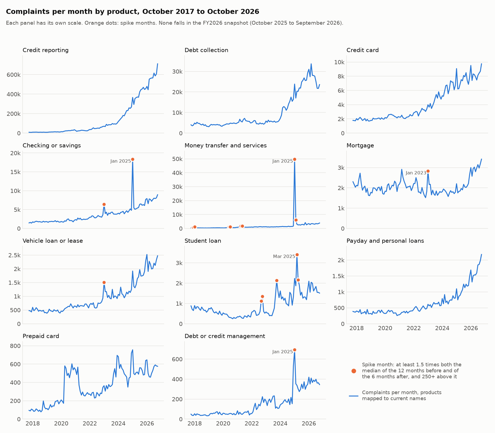
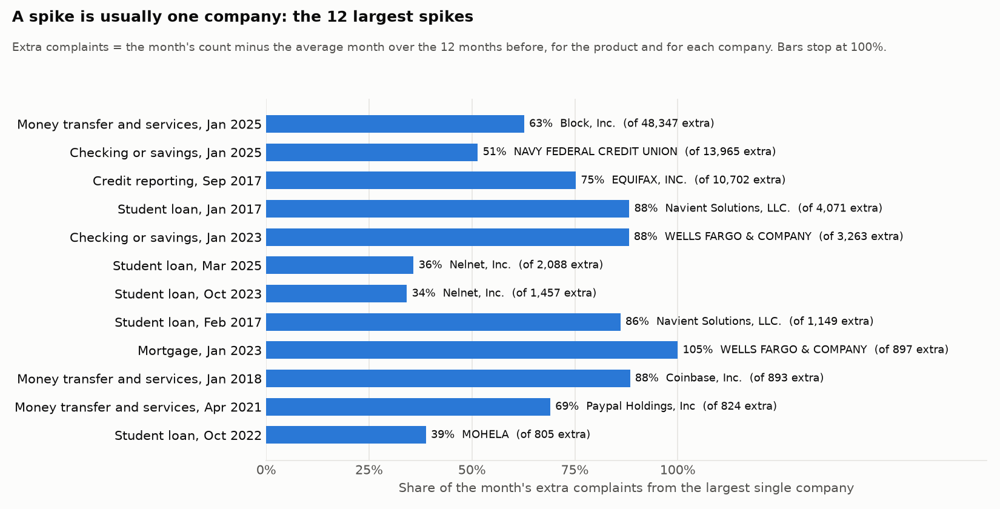
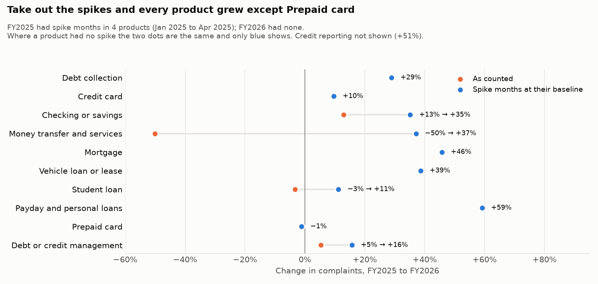
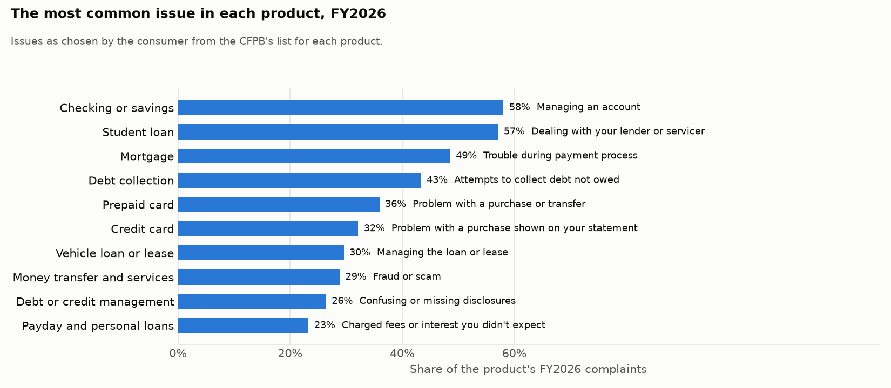

# Part 2: where complaints come from

Generated by `scripts/sources_report.py` from the committed data. Do not edit by hand.

## Short answer

- **A spike is usually one company.** The history has 24 spike months (far above both the months before and the months after). In 19 of them a single company accounts for half or more of the extra complaints. In January 2025, Block, Inc. and Early Warning Services made up 97% of the money-transfer spike (49,743 complaints against a usual 2,738), and Navy Federal Credit Union and Capital One 84% of the bank-account spike.
- **Spikes distort year-on-year figures.** Counted as filed, money-transfer complaints fell −50.1% from FY2025 to FY2026; with the spike months set to their baseline they rose +37.1%. Bank accounts go from +12.9% to +35.1%, student loans from −3.4% to +11.2%.
- **Underneath, complaints grew in 9 of 10 products** (credit reporting aside). Prepaid cards are flat (−1.2%). The largest rises: payday and personal loans +59.1%, mortgages +45.7%, vehicle loans +38.6%. The growth is broad: in debt collection 1,995 companies had more complaints a month and 1,076 fewer, and the largest single contributor added 19% of the rise.
- **No spike falls inside the FY2026 snapshot**, by month (0 of 24) or by week (none of 350 product-weeks), and none of the monthly thresholds tried finds one. So the FY2026 product and issue mix that Parts 3 and 4 build on is not one event's footprint.
- **The largest issue in debt collection is debts people say they don't owe** (43.3% of its complaints). In 9 of 10 products the most common issue is a quarter or more of complaints, which tells a complaints team where root-cause work pays off first.
- **The repeats and the two-way spellings change nothing material.** Without the 17,349 repeats no product's share moves by more than 1.0 percentage points, every product keeps its top issue and the top-10 companies stay the same 10, though 6 of them change places.

## 1. Old product names, mapped onto current ones

The CFPB changed its product list in April 2017 and August 2023. To compare years, every complaint is put under the product it would be filed under today (`complaints/taxonomy.py`). The history has 127 product and sub-product pairs as filed; 2,672,241 complaints (13.8% of 19,397,176) move: 2,670,877 filed under a product name that no longer exists, and 1,364 filed under a current name with a sub-product that has since moved to another product. Four products were later split, so they are mapped by sub-product (for example, prepaid sub-products of "Credit card or prepaid card" go to Prepaid card). Every complaint lands on exactly one of the 11 current products, and the total is unchanged (tested).

| Current product | Filed as | Sub-products | Complaints | Used |
| --- | --- | ---: | ---: | --- |
| Checking or savings | Bank account or service | 4 | 85,573 | 2012-03 to 2017-04 |
| Credit card | Credit card or prepaid card | 3 | 186,789 | 2017-04 to 2023-08 |
| Credit reporting | Credit reporting, credit repair services, or other personal consumer reports | 3 | 2,158,704 | 2017-04 to 2023-08 |
| Credit reporting | Credit reporting | 1 | 140,426 | 2012-10 to 2017-04 |
| Debt or credit management | Credit reporting, credit repair services, or other personal consumer reports | 1 | 5,064 | 2017-04 to 2023-08 |
| Debt or credit management | Money transfer, virtual currency, or money service | 1 | 946 | 2017-04 to 2023-08 |
| Debt or credit management | Other financial service | 2 | 433 | 2014-07 to 2017-04 |
| Money transfer and services | Money transfers | 2 | 5,354 | 2013-04 to 2017-04 |
| Money transfer and services | Bank account or service | 1 | 625 | 2012-03 to 2017-04 |
| Money transfer and services | Other financial service | 5 | 623 | 2014-07 to 2017-04 |
| Money transfer and services | Prepaid card | 1 | 418 | 2014-07 to 2017-04 |
| Money transfer and services | Virtual currency | 2 | 18 | 2014-08 to 2017-04 |
| Payday and personal loans | Payday loan, title loan, or personal loan | 6 | 30,614 | 2017-04 to 2023-08 |
| Payday and personal loans | Consumer Loan | 4 | 11,136 | 2012-03 to 2017-04 |
| Payday and personal loans | Payday loan | 1 | 5,528 | 2013-11 to 2017-04 |
| Prepaid card | Credit card or prepaid card | 5 | 19,567 | 2017-04 to 2023-08 |
| Vehicle loan or lease | Consumer Loan | 2 | 20,423 | 2012-03 to 2017-04 |

Every pair, with its rule, is in `results/product_map.csv`. One limit: "Debt or credit management" only became a product in August 2023, and two of its sub-products (mortgage modification or foreclosure avoidance, and student loan debt relief) have no earlier equivalent in the list. Earlier complaints of that kind cannot be traced, so its long-run growth is not like for like.

## 2. Spikes: one company, one month

**The rule** (`sql/product_months.sql`): a month is a spike when it is at least 1.5 times the larger of two baselines, the median of the 12 months before and the median of the 6 months after, and at least 250 complaints above it. Comparing with the months after as well as before separates a one-off from a new level: the growth of credit reporting from 2020 on is never flagged, because the months after are as high.

**Who is behind it** (`sql/spike_companies.sql`): each company's complaints in the spike month minus its own average month over the 12 months before. These company excesses add up exactly to the product's excess over its 12-month average.

| Month | Product | Complaints | Baseline | Times baseline | Largest company | Its share of the extra |
| --- | --- | ---: | ---: | ---: | --- | ---: |
| Oct 2015 | Prepaid card | 682 | 105 | 6.5 | Empowerment Ventures, LLC | 100% |
| Jan 2017 | Student loan | 4,745 | 1,235 | 3.8 | Navient Solutions, LLC. | 88% |
| Feb 2017 | Student loan | 2,190 | 1,026 | 2.1 | Navient Solutions, LLC. | 86% |
| Mar 2017 | Student loan | 1,721 | 1,021 | 1.7 | Navient Solutions, LLC. | 80% |
| Apr 2017 | Student loan | 1,441 | 954 | 1.5 | Navient Solutions, LLC. | 100% |
| Sep 2017 | Credit reporting | 16,022 | 9,138 | 1.8 | EQUIFAX, INC. | 75% |
| Dec 2017 | Money transfer and services | 709 | 428 | 1.7 | Coinbase, Inc. | 86% |
| Jan 2018 | Money transfer and services | 1,210 | 383 | 3.2 | Coinbase, Inc. | 88% |
| Jun 2020 | Money transfer and services | 1,142 | 673 | 1.7 | PNC Bank N.A. | 63% |
| Jul 2020 | Money transfer and services | 1,172 | 673 | 1.7 | PNC Bank N.A. | 62% |
| Apr 2021 | Money transfer and services | 1,703 | 902 | 1.9 | Paypal Holdings, Inc | 69% |
| May 2021 | Money transfer and services | 1,740 | 902 | 1.9 | Paypal Holdings, Inc | 58% |
| Sep 2022 | Student loan | 1,120 | 554 | 2.0 | EdFinancial Services | 70% |
| Oct 2022 | Student loan | 1,354 | 524 | 2.6 | MOHELA | 39% |
| Jan 2023 | Checking or savings | 6,395 | 4,014 | 1.6 | WELLS FARGO & COMPANY | 88% |
| Jan 2023 | Mortgage | 2,837 | 1,808 | 1.6 | WELLS FARGO & COMPANY | 105% |
| Jan 2023 | Vehicle loan or lease | 1,505 | 994 | 1.5 | WELLS FARGO & COMPANY | 62% |
| Oct 2023 | Student loan | 2,130 | 1,306 | 1.6 | Nelnet, Inc. | 34% |
| Jan 2025 | Checking or savings | 18,367 | 5,423 | 3.4 | NAVY FEDERAL CREDIT UNION | 51% |
| Jan 2025 | Debt or credit management | 693 | 320 | 2.2 | John C. Heath, Attorney at Law, PLLC | 49% |
| Jan 2025 | Money transfer and services | 49,743 | 2,738 | 18.2 | Block, Inc. | 63% |
| Feb 2025 | Money transfer and services | 6,128 | 2,738 | 2.2 | Block, Inc. | 102% |
| Mar 2025 | Student loan | 3,413 | 1,482 | 2.3 | Nelnet, Inc. | 36% |
| Apr 2025 | Student loan | 2,159 | 1,366 | 1.6 | MOHELA | 36% |

A share above 100% means the other companies together had fewer complaints than their usual month. In 19 of the 24 spikes one company makes up half or more of the extra complaints, and in all of them the two largest companies do. The data does not say why any spike happened. Some come in the same month as a public event about the company behind most of the spike, or the month after it (timing alone does not show cause):

- Student loan, January 2017: Navient Solutions, LLC. drew 88% of the extra complaints; the CFPB sued Navient on 18 January 2017 ([source](https://www.consumerfinance.gov/enforcement/actions/navient-corporation-navient-solutions-inc-and-pioneer-credit-recovery-inc/)).
- Credit reporting, September 2017: EQUIFAX, INC. drew 75% of the extra complaints; Equifax disclosed its data breach on or about 7 September 2017 ([source](https://www.ftc.gov/news-events/news/press-releases/2019/07/equifax-pay-575-million-part-settlement-ftc-cfpb-states-related-2017-data-breach)).
- Checking or savings, January 2023: WELLS FARGO & COMPANY drew 88% of the extra complaints; on 20 December 2022 the CFPB ordered Wells Fargo to pay $3.7 billion over its handling of auto loans, mortgages and deposit accounts ([source](https://www.consumerfinance.gov/enforcement/actions/wells-fargo-bank-na-2022/)).

In January 2023 Wells Fargo leads the spike in 3 products at once (checking or savings, mortgage, vehicle loan or lease), the three areas named in the December 2022 order.

**Sensitivity** (`results/spike_sensitivity.csv`): the count of spike months depends on the thresholds, but no setting finds one inside FY2026.

| Times baseline | Min. extra | Spike months | Products | In FY2025 | In FY2026 |
| ---: | ---: | ---: | ---: | ---: | ---: |
| 1.3 | 250 | 32 | 8 | 7 | 0 |
| 1.5 | 100 | 26 | 8 | 7 | 0 |
| 1.5 | 250 | 24 | 8 | 6 | 0 |
| 2.0 | 250 | 11 | 5 | 5 | 0 |

Months too recent to have 6 later months (May to October 2026) are checked against the 12 months before only: 0 flagged. Weeks inside the snapshot (`sql/weekly_spikes.sql`, the same rule against the 8 weeks before and after, at least 100 above): none flagged; the highest was student loan in the week of 5 January 2026, 1.27 times its baseline.

## 3. Growth, with and without the spikes

Spike months set to their baseline (the larger of the two medians); every other month as counted. FY2019 is the first year after the April 2017 product list settled.

| Product | FY2025 | FY2026 | Change | Change without spikes | FY2019 to FY2026 | Without spikes |
| --- | ---: | ---: | ---: | ---: | ---: | ---: |
| Credit reporting | 4,218,343 | 6,349,302 | +50.5% | +50.5% | 49.3x | 49.3x |
| Debt collection | 252,026 | 324,870 | +28.9% | +28.9% | 7.0x | 7.0x |
| Credit card | 87,813 | 96,251 | +9.6% | +9.6% | 4.2x | 4.2x |
| Checking or savings | 78,783 | 88,979 | +12.9% | +35.1% | 4.1x | 4.1x |
| Money transfer and services | 79,271 | 39,582 | −50.1% | +37.1% | 8.5x | 8.5x |
| Mortgage | 23,050 | 33,587 | +45.7% | +45.7% | 1.5x | 1.5x |
| Vehicle loan or lease | 18,384 | 25,486 | +38.6% | +38.6% | 4.7x | 4.7x |
| Student loan | 20,813 | 20,113 | −3.4% | +11.2% | 2.7x | 2.7x |
| Payday and personal loans | 11,763 | 18,720 | +59.1% | +59.1% | 4.4x | 4.4x |
| Prepaid card | 6,521 | 6,444 | −1.2% | −1.2% | 3.7x | 3.7x |
| Debt or credit management | 4,186 | 4,411 | +5.4% | +15.7% | 7.1x | 7.1x |

FY2019 and FY2026 have no spike months, so the seven-year multiples are the same either way. The money-transfer multiple is large because the product had few complaints in FY2019.

## 4. Who is behind the FY2026 growth

Average complaints per month in FY2025 and FY2026 over each product's non-spike months, split by company (`sql/fy_change_by_company.sql`; company changes add up exactly to the product's change). "Largest share" is the part of the change from the single company that moved most, shown only where the product changed by at least 5%.

| Product | Per month FY2025 | Per month FY2026 | Companies up / down | Largest share | Companies that added most (complaints per month) |
| --- | ---: | ---: | ---: | ---: | --- |
| Credit reporting | 351,529 | 529,108 | 1,345 / 1,021 | 40% | TRANSUNION INTERMEDIATE HOLDINGS, INC. (+70,609); Experian Information Solutions Inc. (+54,513); EQUIFAX, INC. (+49,935) |
| Debt collection | 21,002 | 27,073 | 1,995 / 1,076 | 19% | CL Holdings LLC (+1,157); ENCORE CAPITAL GROUP INC. (+670); Portfolio Recovery Associates, LLC (+609) |
| Credit card | 7,318 | 8,021 | 367 / 284 | 54% | CAPITAL ONE FINANCIAL CORPORATION (+381); CITIBANK, N.A. (+372); SYNCHRONY FINANCIAL (+277) |
| Checking or savings | 5,492 | 7,415 | 407 / 215 | 19% | Chime Financial Inc (+365); BANK OF AMERICA, NATIONAL ASSOCIATION (+254); WELLS FARGO & COMPANY (+206) |
| Money transfer and services | 2,340 | 3,298 | 362 / 231 | 42% | Paypal Holdings, Inc (+407); Block, Inc. (+144); Chime Financial Inc (+127) |
| Mortgage | 1,921 | 2,799 | 639 / 358 | 26% | Rocket Mortgage, LLC (+230); Shellpoint Partners, LLC (+45); PENNYMAC LOAN SERVICES, LLC. (+45) |
| Vehicle loan or lease | 1,532 | 2,124 | 416 / 251 | 13% | SANTANDER HOLDINGS USA, INC. (+80); Westlake Services, LLC (+67); ALLY FINANCIAL INC. (+54) |
| Student loan | 1,524 | 1,676 | 127 / 97 | 32% | Nelnet, Inc. (+48); Servicer under contract with Federal Student Aid (+46); Central Research Inc (+32) |
| Payday and personal loans | 980 | 1,560 | 615 / 337 | 18% | Affirm Holdings, Inc (+107); Paramount GR Holdings, LLC (+50); Klarna AB (+35) |
| Prepaid card | 543 | 537 | 101 / 72 | - | AMERICAN EXPRESS COMPANY (-73); BANK OF AMERICA, NATIONAL ASSOCIATION (-16); EQUIFAX, INC. (-7) |
| Debt or credit management | 318 | 368 | 462 / 370 | 18% | Consumer Financial Services Solutions, Inc. (+9); Experian Information Solutions Inc. (+7); EQUIFAX, INC. (+6) |

Outside credit reporting, the most concentrated rise is credit card: CAPITAL ONE FINANCIAL CORPORATION made up 54% of it. In every other product that rose by 5% or more, the largest single company is under half of the change. In all 11 products more companies gained complaints than lost them. For a company, that means a rise in its own complaints in FY2026 is more likely part of a market-wide trend than a problem of its own; Part 3 checks this against peers.

## 5. What FY2026 complaints are about

The three most common issues in each product (`sql/issue_mix.sql`; all issues in `results/issue_mix_fy2026.csv`):

| Product | # | Issue | Complaints | Share of product |
| --- | ---: | --- | ---: | ---: |
| Checking or savings | 1 | Managing an account | 51,655 | 58.1% |
| Checking or savings | 2 | Problem with a lender or other company charging your account | 12,718 | 14.3% |
| Checking or savings | 3 | Closing an account | 11,743 | 13.2% |
| Credit card | 1 | Problem with a purchase shown on your statement | 30,936 | 32.1% |
| Credit card | 2 | Getting a credit card | 10,959 | 11.4% |
| Credit card | 3 | Other features, terms, or problems | 10,889 | 11.3% |
| Debt collection | 1 | Attempts to collect debt not owed | 140,813 | 43.3% |
| Debt collection | 2 | Took or threatened to take negative or legal action | 79,919 | 24.6% |
| Debt collection | 3 | Written notification about debt | 52,370 | 16.1% |
| Debt or credit management | 1 | Confusing or missing disclosures | 1,165 | 26.4% |
| Debt or credit management | 2 | Didn't provide services promised | 1,085 | 24.6% |
| Debt or credit management | 3 | Charged upfront or unexpected fees | 646 | 14.6% |
| Money transfer and services | 1 | Fraud or scam | 11,420 | 28.9% |
| Money transfer and services | 2 | Other transaction problem | 7,444 | 18.8% |
| Money transfer and services | 3 | Unauthorized transactions or other transaction problem | 6,877 | 17.4% |
| Mortgage | 1 | Trouble during payment process | 16,307 | 48.6% |
| Mortgage | 2 | Struggling to pay mortgage | 9,403 | 28.0% |
| Mortgage | 3 | Applying for a mortgage or refinancing an existing mortgage | 3,312 | 9.9% |
| Payday and personal loans | 1 | Charged fees or interest you didn't expect | 4,358 | 23.3% |
| Payday and personal loans | 2 | Problem when making payments | 3,077 | 16.4% |
| Payday and personal loans | 3 | Struggling to pay your loan | 1,930 | 10.3% |
| Prepaid card | 1 | Problem with a purchase or transfer | 2,315 | 35.9% |
| Prepaid card | 2 | Trouble using the card | 2,159 | 33.5% |
| Prepaid card | 3 | Problem getting a card or closing an account | 1,099 | 17.1% |
| Student loan | 1 | Dealing with your lender or servicer | 11,482 | 57.1% |
| Student loan | 2 | Struggling to repay your loan | 3,711 | 18.5% |
| Student loan | 3 | Incorrect information on your report | 3,043 | 15.1% |
| Vehicle loan or lease | 1 | Managing the loan or lease | 7,532 | 29.6% |
| Vehicle loan or lease | 2 | Repossession | 6,807 | 26.7% |
| Vehicle loan or lease | 3 | Problems at the end of the loan or lease | 3,883 | 15.2% |

Read as a to-do list, the top issues point at different teams: disputed debts and debt validation (debt collection), purchase disputes on statements (credit cards), account management (bank accounts), fraud and scams (money transfers), payment processing (mortgages) and servicing (student loans).

## 6. Do the repeats or the two-way spellings change anything?

Company names that differ only in case, spaces or punctuation are merged under their most common spelling (`sql/company_names.sql`): 4 companies, 392 FY2026 complaints. The figures below use merged names, with and without the 17,349 repeats (complaints identical to an earlier one on every field except the ID).

| Figure | With repeats | Without repeats |
| --- | ---: | ---: |
| Companies | 3,985 | 3,985 |
| Top-10 share | 30.8% | 30.3% |
| Companies for half of all complaints | 22 | 23 |
| Companies with one complaint | 1,102 | 1,110 |
| Debt collection share | 49.3% | 48.4% |

Product order and every product's top issue are the same without the repeats; the largest move in an issue's share is 1.3 percentage points. The top 10 companies are the same 10, but the order at the top depends on the repeats:

| Company | Rank | Rank without repeats |
| --- | ---: | ---: |
| CL Holdings LLC | 1 | 2 |
| CAPITAL ONE FINANCIAL CORPORATION | 2 | 1 |
| JPMORGAN CHASE & CO. | 3 | 3 |
| ENCORE CAPITAL GROUP INC. | 4 | 7 |
| BANK OF AMERICA, NATIONAL ASSOCIATION | 5 | 4 |
| WELLS FARGO & COMPANY | 6 | 5 |
| CITIBANK, N.A. | 7 | 6 |
| Resurgent Capital Services L.P. | 8 | 8 |
| Portfolio Recovery Associates, LLC | 9 | 9 |
| Block, Inc. | 10 | 10 |

The companies that drop furthest have more repeats than the snapshot's 2.6%: ENCORE CAPITAL GROUP INC. 8.5% (rank 4 to 7); CL Holdings LLC 6.8% (rank 1 to 2). That fits one person disputing several debts on the same day, but the data cannot tell that apart from a duplicate. A ranking of companies by raw count should say whether repeats are in it.

## 7. What this means for the business

1. **Check for a spike before reading any year-on-year change.** One month at one company can turn growth into an apparent 50% fall. Report changes with and without spike months, as here.
2. **When a spike comes, look for the company first.** In all 24 spikes the two largest companies make up half or more of the extra complaints, and some spikes match public events about the company (an enforcement action, a data breach). A complaints team should be ready for a surge after public news about its own firm.
3. **FY2026 growth is broad, not one firm's.** In all 11 products more companies gained complaints than lost them, so a company whose complaints rose in line with its market may not have a problem of its own; Part 3 compares companies with their peers.
4. **Start root-cause work with the top issue.** In 9 of 10 products the most common issue is a quarter or more of complaints (up to 58%).
5. **Say whether repeats are counted** when ranking companies, especially debt collectors.
